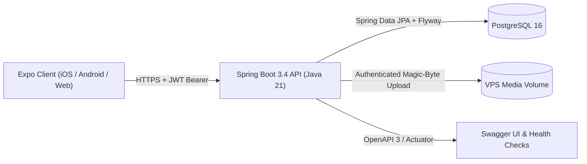
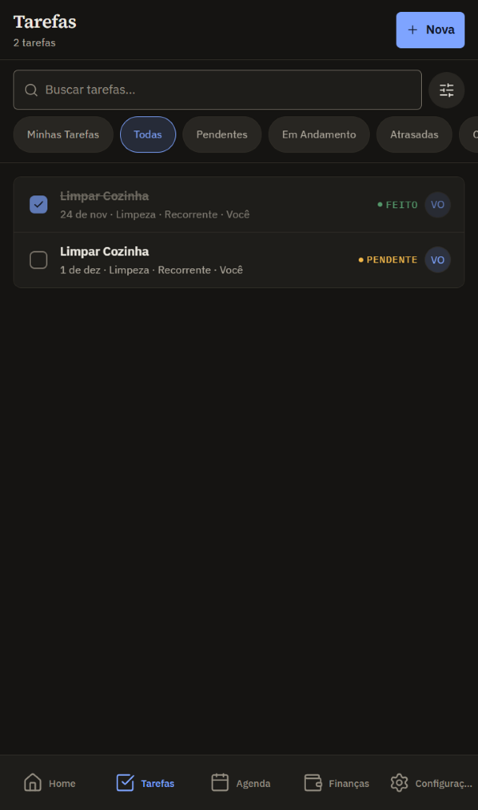

# Alpendre

[](https://github.com/leosaponisouza/rep-helper/actions/workflows/ci.yml)
[](https://github.com/leosaponisouza/rep-helper/releases)


[](LICENSE)

**Alpendre** (*"Rotina, contas e agenda para quem divide o mesmo teto"* — evolved from *RepHelper*) is a full-stack shared-household management platform for **couples, families, roommates sharing an apartment, and student residences ("repúblicas")**. Built as a unified monorepo, it pairs a **Java 21 + Spring Boot 3.4 + PostgreSQL 16** REST API (`com.alpendre.backend`) with a **React Native / Expo (Mobile & Web)** client (`com.alpendre.app`), engineered for self-hosted single-VPS deployment with zero external BaaS dependencies.

---

## Architecture Overview

Alpendre eliminates third-party BaaS lock-in (zero Firebase Auth, zero Supabase Storage) in favor of an internal, auditable backend architecture:



### Configurable Household Presets & Rule Matrix

Instead of hardcoding student-housing bureaucracy for every home, each `House` combines an initial preset with three customizable governance switches (editable anytime in *House Settings*):

| Preset (`presetType`) | Target Household | Shared Fund (`hasSharedFund`) | Expense Approval (`requireExpenseApproval`) | Shared Admin (`allMembersAdmin`) | Financial Mode |
|---|---|:-:|:-:|:-:|---|
| **`COUPLE_FAMILY`** *(Default)* | Couples & Families | `false` | `false` | `true` | Lightweight monthly expense tracking (*"Registrada"*, zero balance mutation) |
| **`SHARED_APT`** | Roommates / Shared Apt | `false` | `false` | `false` | Monthly expense tracking with owner/admin governance |
| **`REPUBLIC`** | Student Residences | `true` | `true` | `false` | Collective fund (*"Caixinha"*) + `PENDING` → `APPROVED` → `REIMBURSED` workflow |
| **`CUSTOM`** | Any custom combination | *User-defined* | *User-defined* | *User-defined* | Adapts automatically across all `2 × 2` financial state machines |

### Key Engineering Highlights

| Domain | Implementation Details |
|---|---|
| **Authentication & Security** | Stateless **Spring Security 6 + JWT** with refresh-token rotation, BCrypt password hashing, 2-step 6-digit OTP password recovery, Google OAuth ID-token verification, correlation IDs, and per-route rate limiting. |
| **Multi-Tenant Governance (RBAC)** | Household (`house`) isolation enforced server-side (`HouseSecurityService`) with optional postal address, `OWNER` / `ADMIN` / `MEMBER` roles, automatic `allMembersAdmin` promotion/demotion (with strict `OWNER` protection), and invite code rotation. |
| **Adaptive Financial Ledger (`2 × 2`)** | Pessimistic-locked `HouseBalanceLedger` (`SELECT ... FOR UPDATE`), cross-mode reimbursement eligibility guards (`EXPENSE_NOT_IN_SHARED_FUND`, `SHARED_FUND_DISABLED`), income tracking, manual balance adjustments, and monthly/category analytics. |
| **Recurring Household Tasks** | Filtered/paginated chore engine with status transitions (`PENDING` → `IN_PROGRESS` → `COMPLETED`) and idempotent next-occurrence scheduling (`DAILY`, `WEEKLY`, `MONTHLY`, `YEARLY`). |
| **Agenda & Optional RSVP** | Household calendar with `OffsetDateTime` timezone preservation, optional attendance confirmation (`requireRsvp = true` with `INVITED` / `CONFIRMED` / `DECLINED`, or `requireRsvp = false` informational *"Aviso na agenda"*), device calendar sync, and in-app notification center. |
| **Editorial Design System** | Custom React Native / Web design system (`Alpendre` arch identity, light/dark/system themes, semantic tokens, WCAG contrast & clean-slate guardrails) verified by **29 Jest suites (137 tests)**. |

---

## Visual Showcase (Historical E2E QA Baseline)

Captured from live end-to-end browser verification (`Expo Web` + `Spring Boot` + `Flyway`) prior to the *RepHelper → Alpendre* domain repositioning — full QA baseline in [`docs/qa/relatorio-testes-alpha.md`](docs/qa/relatorio-testes-alpha.md).

<table>
  <tr>
    <td align="center">
      <br />
      <sub><b>Home Dashboard</b></sub>
    </td>
    <td align="center">
      <br />
      <sub><b>Adaptive Finances</b></sub>
    </td>
    <td align="center">
      <br />
      <sub><b>Recurring Tasks</b></sub>
    </td>
  </tr>
  <tr>
    <td align="center">
      <br />
      <sub><b>Agenda &amp; Events</b></sub>
    </td>
    <td align="center">
      <br />
      <sub><b>Editorial Dark Theme</b></sub>
    </td>
    <td align="center">
      <br />
      <sub><b>Editorial Light Theme</b></sub>
    </td>
  </tr>
</table>

---

## Repository Structure

```text
alpendre/
├── .github/workflows/    # GitHub Actions CI (Maven JDK 21 + Node 22 Typecheck & Jest)
├── backend/              # Java 21, Spring Boot 3.4, Spring Security, JPA, Flyway, OpenAPI (com.alpendre.backend)
├── frontend/             # React Native, Expo Router, TypeScript, Editorial Design System (com.alpendre.app)
├── docs/
│   ├── arquitetura-e-modelagem/  # Functional requirements, REST API contract, PostgreSQL schema & diagrams
│   ├── designs/                  # Monorepo & backend system design specification
│   ├── specs/                    # Spec-Driven Development (SDD) plans & technical specs
│   └── qa/                       # Historical E2E browser QA report & captures
├── docker-compose.yml    # PostgreSQL 16 + Spring Boot API + persistent media volume (/var/lib/alpendre/media)
├── .env.example          # Environment template for local & VPS deployments
└── LICENSE               # MIT License
```

---

## Quick Start

### 1. Run Backend + PostgreSQL (Docker Compose)

```bash
cp .env.example .env
# Update POSTGRES_PASSWORD, JWT_SECRET, and APP_PUBLIC_BASE_URL in .env
docker compose up -d --build
```

- Health check: `GET http://localhost:8080/api/v1/health`
- Interactive OpenAPI / Swagger UI: `http://localhost:8080/swagger-ui.html`

### 2. Run Frontend (Expo Mobile & Web)

```bash
cd frontend
npm install
EXPO_PUBLIC_API_BASE_URL=http://localhost:8080 npm run start
```

---

## Testing & Verification

Automated on every push and pull request via [GitHub Actions CI](.github/workflows/ci.yml):

| Layer | Command | Coverage |
|---|---|---|
| **Backend (Java 21 / Maven)** | `cd backend && mvn test` | 6 Spring Boot MockMvc integration test suites (36 tests: auth, house presets & RBAC, recurring tasks, `2 × 2` financial ledger & mode transitions, optional event RSVP, notifications, media magic bytes) |
| **Frontend (TypeScript / Jest)** | `cd frontend && npm run typecheck && npm run test:ci` | Strict TypeScript typecheck + 29 Jest test suites (137 tests) |

---

## Documentation

- [**Backend Architecture & Java 21 Guide (`backend/README.md`)**](backend/README.md)
- [Introduction & Functional Requirements (`RF01`–`RF07`)](docs/arquitetura-e-modelagem/introducao.md)
- [Architecture Overview](docs/arquitetura-e-modelagem/visao-geral-arquitetura.md)
- [REST API Specification](docs/arquitetura-e-modelagem/especificacao-api-rest.md)
- [Data Model (DER)](docs/arquitetura-e-modelagem/modelo-de-dados.md)
- [PostgreSQL & Flyway Schema](docs/arquitetura-e-modelagem/schema-postgresql-flyway.md)
- [State & Sequence Diagrams](docs/arquitetura-e-modelagem/diagramas-de-estados-e-sequencia.md)
- [Environment & VPS Setup](docs/arquitetura-e-modelagem/setup-ambiente-e-infraestrutura.md)
- [System Design Document](docs/designs/alpendre-backend-monorepo.md)
- [Engineering Specs & Plans (SDD)](docs/specs/)
- [Security Policy](SECURITY.md)

---

## License

Released under the [MIT License](LICENSE).
