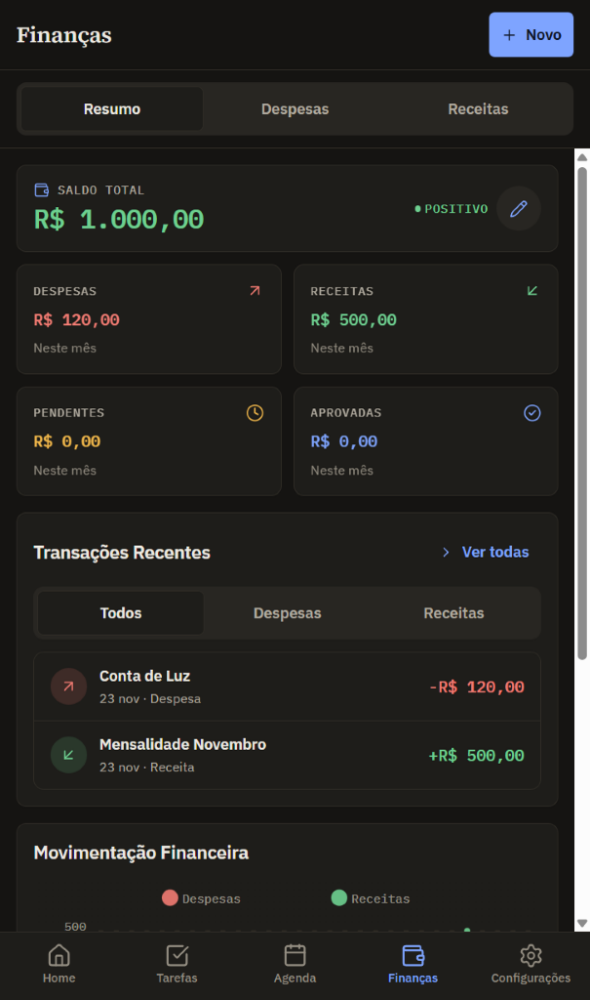
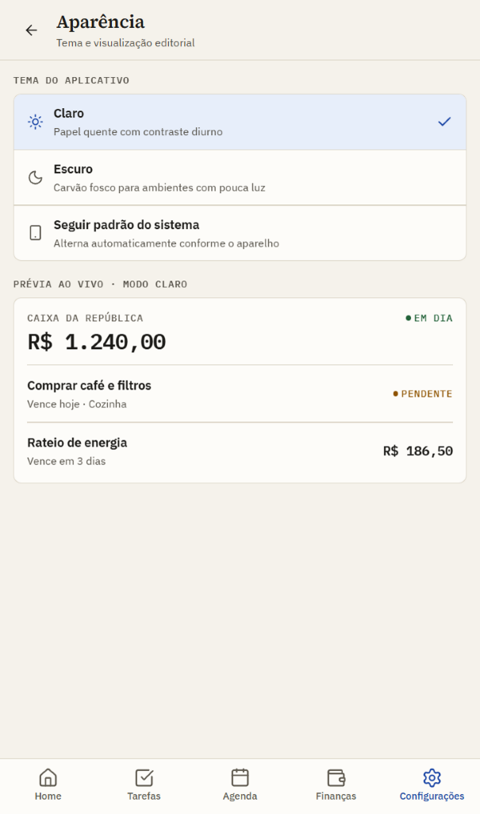

# RepHelper


Full-stack shared-housing ("república estudantil") management platform built as a unified monorepo: a **Java 21 + Spring Boot 3.4 + PostgreSQL 16** REST API paired with a **React Native / Expo (Mobile & Web)** client, engineered for self-hosted single-VPS deployment with zero external BaaS dependencies.

---

## Architecture Overview

RepHelper eliminates third-party BaaS lock-in (previously Firebase Auth + Supabase Storage) in favor of an internal, auditable backend architecture:


### Key Engineering Highlights

| Domain | Implementation Details |
|---|---|
| **Authentication & Security** | Stateless **Spring Security 6 + JWT** with refresh-token rotation, BCrypt password hashing, 2-step OTP password recovery, Google OAuth ID-token verification, correlation IDs, and per-route rate limiting. |
| **Multi-Tenant Membership (RBAC)** | Household ("republic") isolation enforced server-side (`RepublicSecurityService`) with `OWNER`, `ADMIN`, and `MEMBER` roles, invite code generation/regeneration, and member lifecycle tracking. |
| **Recurring Household Tasks** | Filtered/paginated task engine with status transitions (`PENDING` → `IN_PROGRESS` → `COMPLETED`) and automatic next-occurrence scheduling for recurring chores (`DAILY`, `WEEKLY`, `MONTHLY`). |
| **Shared Financial Ledger** | Income tracking, expense approval & reimbursement workflow (`PENDING` → `APPROVED` → `REIMBURSED`), manual balance adjustment, monthly/category analytics, and receipt image uploads. |
| **Events & Notifications** | Household calendar with RSVP status management (`INVITED`, `CONFIRMED`, `DECLINED`), upcoming agenda feed, and in-app notification center. |
| **Editorial Design System** | Custom React Native / Web design system with light/dark/system themes, semantic tokens, WCAG contrast guardrails, and 125 automated Jest unit & component tests. |

---

## Visual Showcase (Alpha E2E)

Captured from live end-to-end browser testing (`Expo Web` + `Spring Boot` + `Flyway`) — full report in [`alpha/relatorio-testes-alpha.md`](alpha/relatorio-testes-alpha.md).

<table>
  <tr>
    <td align="center">
      <br />
      <sub><b>Home Dashboard</b></sub>
    </td>
    <td align="center">
      <br />
      <sub><b>Financial Ledger</b></sub>
    </td>
    <td align="center">
      <br />
      <sub><b>Recurring Tasks</b></sub>
    </td>
  </tr>
  <tr>
    <td align="center">
      <br />
      <sub><b>Events &amp; Calendar</b></sub>
    </td>
    <td align="center">
      <br />
      <sub><b>Editorial Dark Theme</b></sub>
    </td>
    <td align="center">
      <br />
      <sub><b>Editorial Light Theme</b></sub>
    </td>
  </tr>
</table>

---

## Repository Structure

```text
rep-helper/
├── backend/              # Java 21, Spring Boot 3.4, Spring Security, JPA, Flyway, OpenAPI
├── frontend/             # React Native, Expo Router, TypeScript, Editorial Design System
├── docs/                 # Architecture, REST API contract, PostgreSQL schema, design specs
├── alpha/                # End-to-end browser QA report & 22 live application screenshots
├── docker-compose.yml    # PostgreSQL 16 + Spring Boot API + persistent media volume
└── .env.example          # Environment template for local & VPS deployments
```

---

## Quick Start

### 1. Run Backend + PostgreSQL (Docker Compose)

```bash
cp .env.example .env
# Update POSTGRES_PASSWORD, JWT_SECRET, and APP_PUBLIC_BASE_URL in .env
docker compose up -d --build
```

- Health check: `GET http://localhost:8080/api/v1/health`
- Interactive OpenAPI / Swagger UI: `http://localhost:8080/swagger-ui.html`

### 2. Run Frontend (Expo Mobile & Web)

```bash
cd frontend
npm install
EXPO_PUBLIC_API_BASE_URL=http://localhost:8080 npm run start
```

---

## Testing & Verification

| Layer | Command | Coverage |
|---|---|---|
| **Backend (Java 21 / Maven)** | `cd backend && mvn test` | Spring Boot integration & domain tests (H2 PostgreSQL mode + Flyway) |
| **Frontend (TypeScript / Jest)** | `cd frontend && npm run typecheck && npm run test:ci` | Type safety + 26 Jest test suites (125 tests) |
| **Full-Stack E2E (Browser)** | See [`alpha/relatorio-testes-alpha.md`](alpha/relatorio-testes-alpha.md) | 22 end-to-end verified flows across auth, tasks, finances, events, and settings |

---

## Documentation

- [Architecture Overview](docs/arquitetura-e-modelagem/visao-geral-arquitetura.md)
- [REST API Specification](docs/arquitetura-e-modelagem/especificacao-api-rest.md)
- [Data Model](docs/arquitetura-e-modelagem/modelo-de-dados.md)
- [PostgreSQL & Flyway Schema](docs/arquitetura-e-modelagem/schema-postgresql-flyway.md)
- [State & Sequence Diagrams](docs/arquitetura-e-modelagem/diagramas-de-estados-e-sequencia.md)
- [Environment & VPS Setup](docs/arquitetura-e-modelagem/setup-ambiente-e-infraestrutura.md)
- [System Design Document](docs/designs/rep-helper-backend-monorepo.md)
