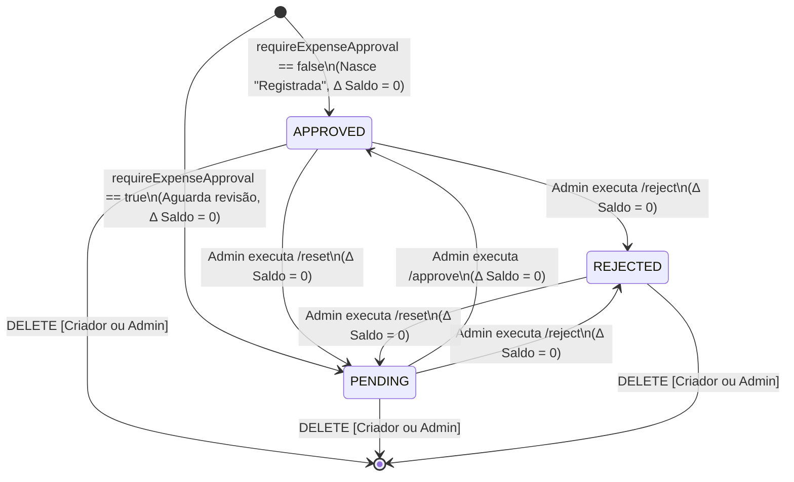
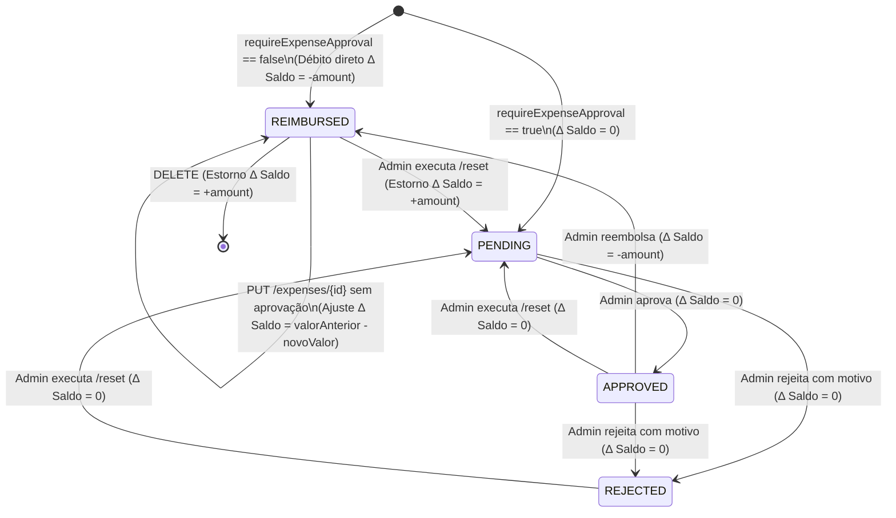
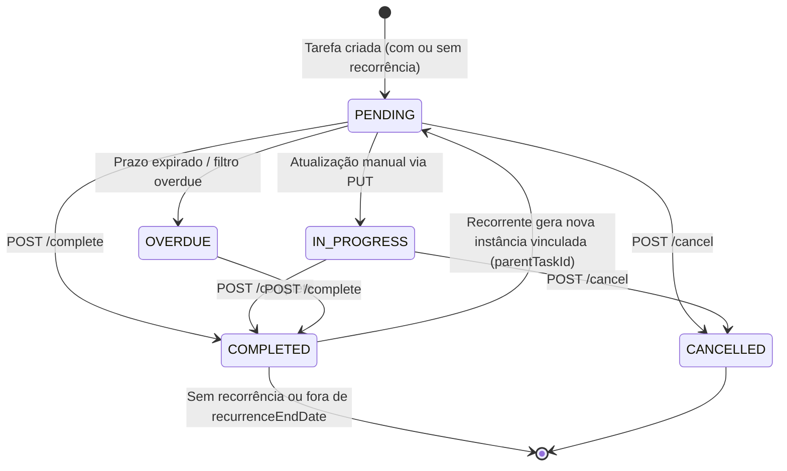
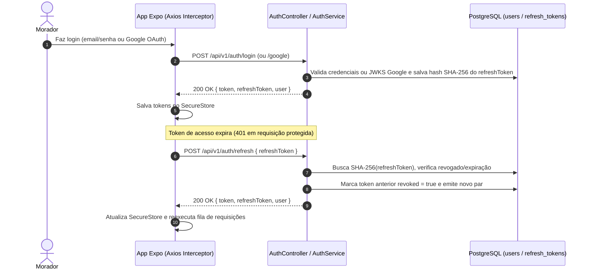
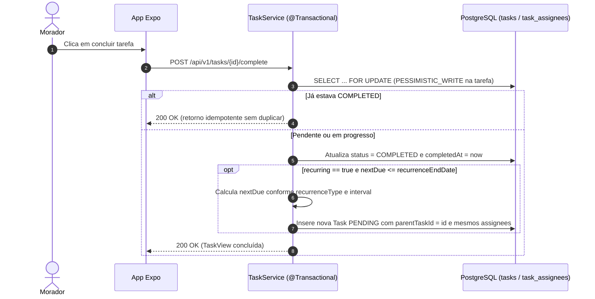
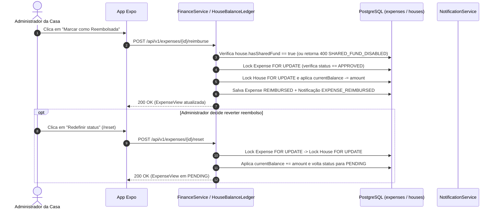
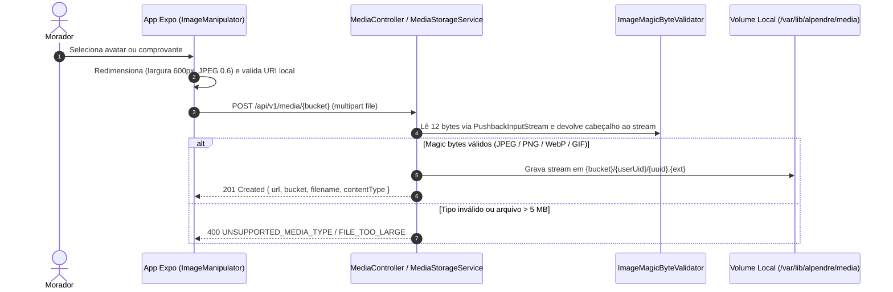

# Diagramas de Máquina de Estados e Sequência — Alpendre

Este documento ilustra os ciclos de vida das entidades e os fluxos transacionais adaptáveis implementados no **Alpendre**.

---

## 1. Máquinas de Estado

### 1.1 Ciclo de Vida Adaptável da Despesa (`Expense`) — Matriz `2 × 2`

#### A) Modo Acompanhar Gastos (`hasSharedFund = false`) — Saldo inalterado (`SHARED_FUND_DISABLED` em entradas/reembolsos)



#### B) Modo Caixinha (`hasSharedFund = true`) — Mutação atômica via `HouseBalanceLedger`



---

### 1.2 Ciclo de Vida da Tarefa (`Task`)



---

## 2. Diagramas de Sequência dos Fluxos Críticos

### 2.1 Autenticação e Rotação de Refresh Token



---

### 2.2 Conclusão Idempotente de Tarefa Recorrente



---

### 2.3 Reembolso e Estorno na Caixinha com Trava Pessimista (`HouseBalanceLedger`)



---

### 2.4 Evento da Agenda com Confirmação Opcional (`requireRsvp`)

```mermaid
sequenceDiagram
    autonumber
    actor Creator as Morador Organizador
    participant App as App Expo
    participant EventSvc as EventService (@Transactional)
    participant DB as PostgreSQL (events / event_invitations)

    Creator->>App: Cria compromisso (toggle requireRsvp = true ou false)
    App->>EventSvc: POST /api/v1/events { title, startDate, endDate, requireRsvp }
    alt requireRsvp == true (Padrão)
        EventSvc->>DB: Salva Event (require_rsvp = true) + criador CONFIRMED em event_invitations
        EventSvc-->>App: 201 Created (habilita convites e botões de presença)
    else requireRsvp == false (Aviso na agenda)
        EventSvc->>DB: Salva Event (require_rsvp = false) sem registros em event_invitations
        EventSvc-->>App: 201 Created (exibe selo "Aviso na agenda"; /invite e /respond retornam 400 RSVP_NOT_ENABLED)
    end
```

---

### 2.5 Upload Seguro de Mídia na VPS


