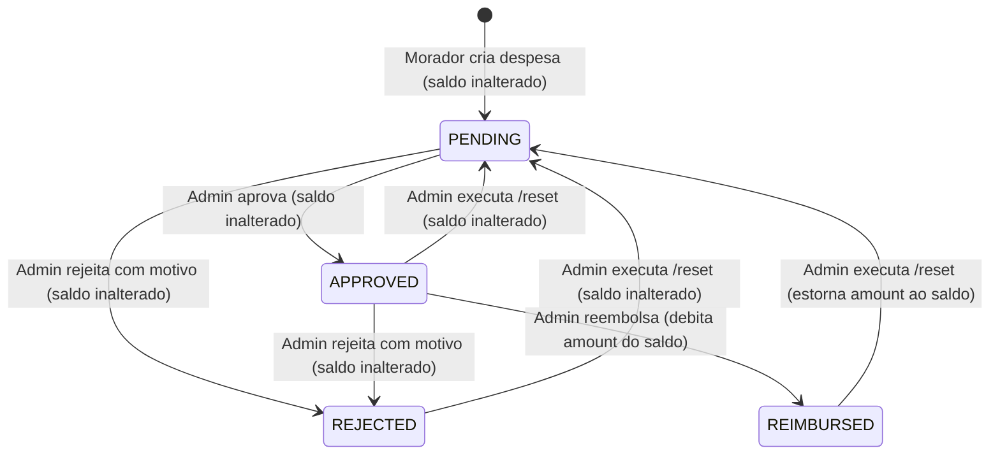
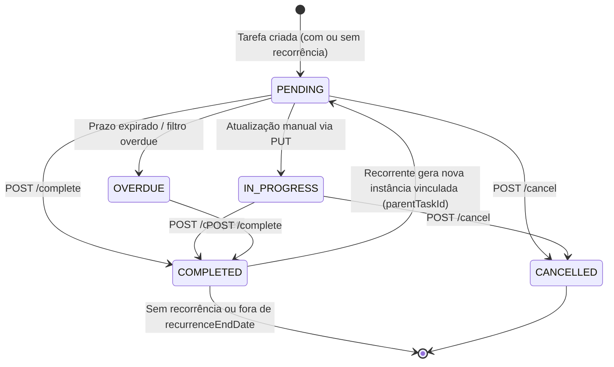
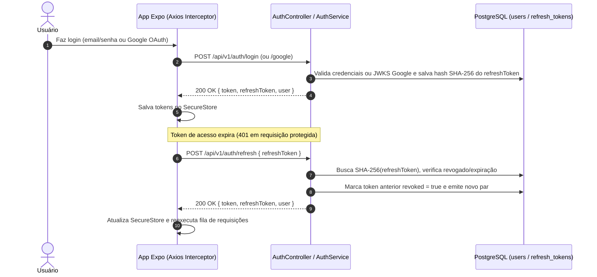
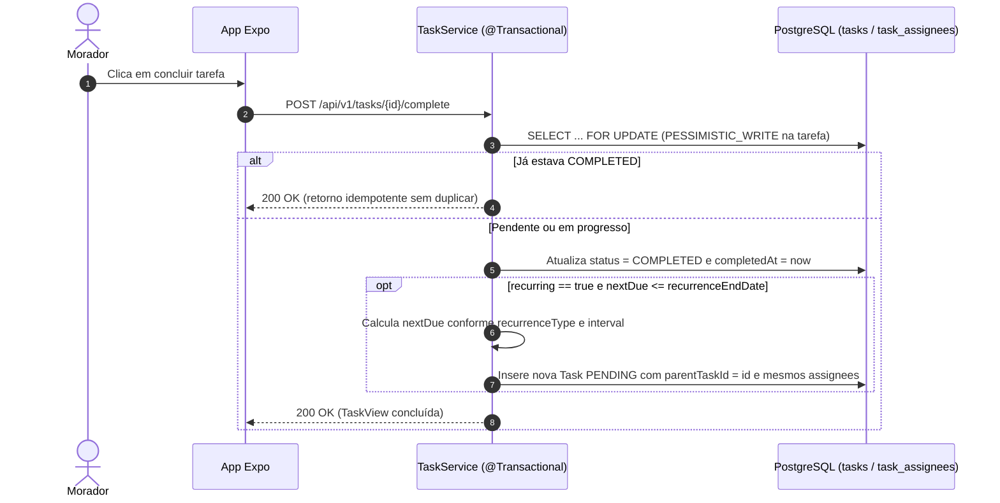
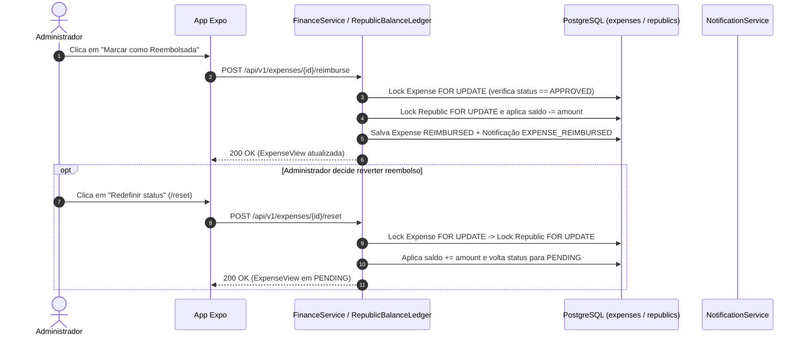
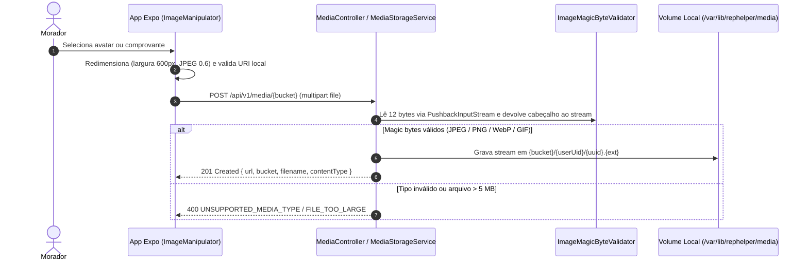

# Diagramas de Máquina de Estados e Sequência

Este documento ilustra os ciclos de vida das entidades e os principais fluxos transacionais implementados no **RepHelper**.

---

## 1. Máquinas de Estado

### 1.1 Ciclo de Vida da Despesa (`Expense`) e Impacto no Saldo

---

### 1.2 Ciclo de Vida da Tarefa (`Task`)

---

## 2. Diagramas de Sequência dos Fluxos Críticos

### 2.1 Autenticação e Rotação de Refresh Token

---

### 2.2 Conclusão Idempotente de Tarefa Recorrente

---

### 2.3 Reembolso e Estorno Financeiro com Trava Pessimista

---

### 2.4 Upload Seguro de Mídia na VPS

