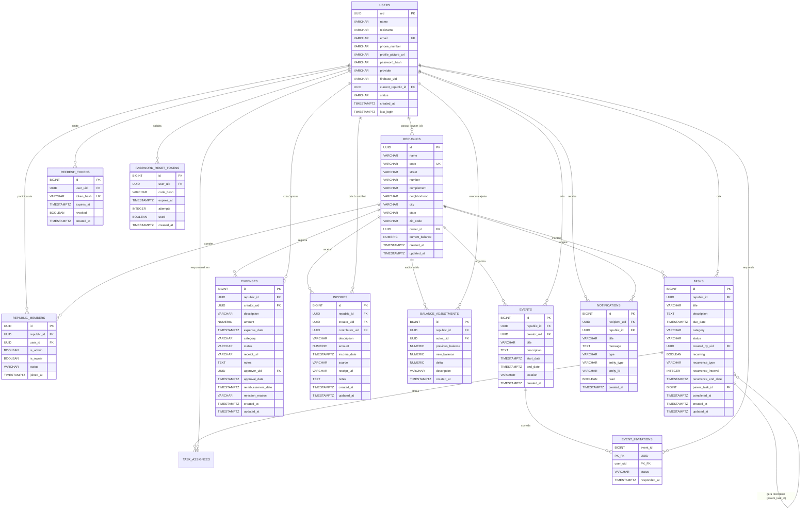

# Modelo de Dados e Diagrama Entidade-Relacionamento (PostgreSQL 16)

Este documento descreve a modelagem relacional do **RepHelper** implementada na migração inicial do Flyway (`V1__init_schema.sql`), alinhada ao banco **PostgreSQL 16** e às entidades JPA do módulo `backend/`.

---

## 1. Diagrama Entidade-Relacionamento (DER)

---

## 2. Dicionário das 13 Tabelas e Restrições de Integridade

| # | Tabela | Chave Primária | Principais Restrições e Índices |
| :--- | :--- | :--- | :--- |
| 1 | `users` | `uid (UUID)` | `email UNIQUE`, `status IN ('active','inactive','banned')`, FK `current_republic_id -> republics(id) ON DELETE SET NULL`. |
| 2 | `republics` | `id (UUID)` | `code UNIQUE` (código de convite de 6 caracteres), endereço embutido (`street`..`zip_code`), `current_balance NUMERIC(14,2) DEFAULT 0.00`, FK `owner_id -> users(uid) ON DELETE RESTRICT`. |
| 3 | `republic_members` | `id (UUID)` | `UNIQUE (republic_id, user_id)`, `status IN ('ACTIVE','INACTIVE','PENDING','BANNED')`, índices por `(republic_id, status)` e `(user_id, status)`. |
| 4 | `refresh_tokens` | `id (BIGINT IDENTITY)` | `token_hash VARCHAR(64) UNIQUE` (SHA-256), índice `(user_uid, revoked)`. |
| 5 | `password_reset_tokens` | `id (BIGINT IDENTITY)` | `code_hash VARCHAR(64)` (SHA-256 do código de 6 dígitos), `attempts INTEGER`, índice `(user_uid, created_at DESC)`. |
| 6 | `tasks` | `id (BIGINT IDENTITY)` | `status IN ('PENDING','IN_PROGRESS','COMPLETED','OVERDUE','CANCELLED')`, `recurrence_type IN ('DAILY','WEEKLY','MONTHLY','YEARLY')`, `recurrence_interval >= 1`, `parent_task_id -> tasks(id) ON DELETE SET NULL`, índice `(republic_id, status, due_date)`. |
| 7 | `task_assignees` | `(task_id, user_uid)` | Tabela associativa `N:N` com `ON DELETE CASCADE` e índice em `(user_uid)`. |
| 8 | `expenses` | `id (BIGINT IDENTITY)` | `amount > 0`, `status IN ('PENDING','APPROVED','REJECTED','REIMBURSED')`, FKs para `creator_uid (RESTRICT)` e `approver_uid (SET NULL)`, índice `(republic_id, status, expense_date DESC)`. |
| 9 | `incomes` | `id (BIGINT IDENTITY)` | `amount > 0`, FKs para `creator_uid (RESTRICT)` e `contributor_uid (SET NULL)`, índice `(republic_id, income_date DESC)`. |
| 10 | `balance_adjustments` | `id (BIGINT IDENTITY)` | Auditoria imutável de ajustes diretos de saldo (`previous_balance`, `new_balance`, `delta`), índice `(republic_id, created_at DESC)`. |
| 11 | `events` | `id (BIGINT IDENTITY)` | Regra `CHECK (end_date > start_date)`, índice `(republic_id, start_date, end_date)`. |
| 12 | `event_invitations` | `(event_id, user_uid)` | `status IN ('INVITED','CONFIRMED','DECLINED')`, índice `(user_uid, status)`. |
| 13 | `notifications` | `id (BIGINT IDENTITY)` | `read BOOLEAN DEFAULT FALSE`, índice `(recipient_uid, read, created_at DESC)`. |
