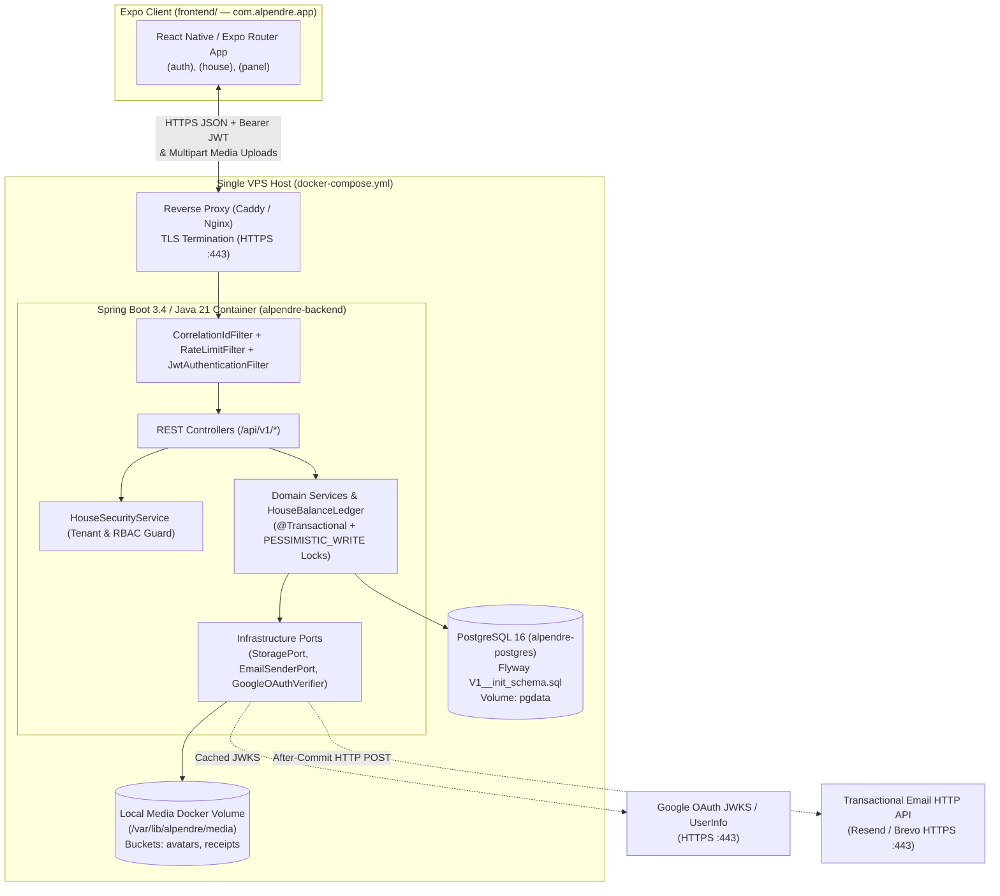

# Alpendre Monorepo & Backend Architecture (Java 21 + Spring Boot 3.4 + PostgreSQL 16 on VPS)

*   **Author:** leosaponisouza
*   **Status:** Implemented (Clean-Slate v1.0)
*   **Date:** 2026-11-27

--------------------------------------------------------------------------------

## Overview

**Alpendre** (*"Rotina, contas e agenda para quem divide o mesmo teto"*) is a full-stack mobile and web platform built with React Native / Expo (`frontend/`, native ID `com.alpendre.app`) and Java 21 / Spring Boot 3.4 / PostgreSQL 16 (`backend/`, package `com.alpendre.backend`) for managing any shared household: **couples, families, roommates sharing an apartment, and student residences ("repúblicas")**.

Rather than locking all households into rigid student-housing rules, Alpendre introduces **Household Presets & Customizable Governance Rules** (`COUPLE_FAMILY`, `SHARED_APT`, `REPUBLIC`, `CUSTOM`), an **Optional Postal Address**, an **Adaptive `2 × 2` Financial Engine** (`hasSharedFund × requireExpenseApproval`), and an **Optional Event RSVP Agenda** (`requireRsvp`), all running self-hosted on a single Virtual Private Server (VPS) via Docker Compose with zero external BaaS dependencies (zero Firebase Auth, zero Supabase Storage).

---

## Goals & Architectural Pillars

*   **G1 — Unified Self-Hosted Monorepo:** Co-locate `frontend/`, `backend/`, `docs/`, and `docker-compose.yml` so any shared household or maintainer can deploy the entire stack on a single 2 GB–4 GB RAM VPS (`docker compose up -d --build`).
*   **G2 — 100% Internal Authentication (Zero Firebase):** Stateless Spring Security 6 + HS256 JWT access tokens, SHA-256 hashed rotating refresh tokens, BCrypt password hashing, local Google JWKS RS256 ID-token verification, and 2-step 6-digit password recovery codes dispatched post-commit via HTTPS transactional email (`EmailSenderPort`).
*   **G3 — Internal VPS Media Storage (Zero Supabase):** Authenticated multipart uploads (`POST /api/v1/media/{bucket}` for `avatars` and `receipts`), 5 MB size cap, single-pass 12-byte magic-number validation (`JPEG`, `PNG`, `WebP`, `GIF`), ownership checks, immutable cache headers, and automatic cleanup of superseded files in `/var/lib/alpendre/media`.
*   **G4 — Configurable Household Governance (`houses` & `house_members`):**
    *   `COUPLE_FAMILY` (**Casal / Família** — default): `hasSharedFund = false`, `requireExpenseApproval = false`, `allMembersAdmin = true`.
    *   `SHARED_APT` (**Amigos / Apê**): `hasSharedFund = false`, `requireExpenseApproval = false`, `allMembersAdmin = false`.
    *   `REPUBLIC` (**República**): `hasSharedFund = true`, `requireExpenseApproval = true`, `allMembersAdmin = false`.
    *   `CUSTOM` (**Personalizado**): automatically resolved whenever individual toggles diverge from the 3 presets.
    *   Postal address fields (`street`..`zip_code`) are nullable in PostgreSQL and optional in onboarding/settings.
    *   When `allMembersAdmin = true`, active and newly joining members automatically receive administrative permissions while keeping `isOwner` immutable and protected.
*   **G5 — Adaptive `2 × 2` Financial Engine (`HouseBalanceLedger`):**
    *   `(hasSharedFund = false, requireExpenseApproval = false)`: Expenses are created directly as `APPROVED` (*"Registrada"* in UI) with zero balance mutation; Incomes, Adjust Balance, and Reimburse are disabled (`400 SHARED_FUND_DISABLED`).
    *   `(hasSharedFund = false, requireExpenseApproval = true)`: Expenses start `PENDING` and transition to `APPROVED` upon admin approval without reimbursement or balance mutation; fund-only endpoints remain blocked (`400 SHARED_FUND_DISABLED`).
    *   `(hasSharedFund = true, requireExpenseApproval = false)`: Expenses are created directly as `REIMBURSED`, immediately debiting `-amount` under `PESSIMISTIC_WRITE` lock, with delta adjustments on edit/delete.
    *   `(hasSharedFund = true, requireExpenseApproval = true)`: Full 3-stage workflow (`PENDING` → `APPROVED` → `REIMBURSED`), debiting `-amount` on reimbursement and reversing `+amount` on reset/delete.
*   **G6 — Optional Event RSVP (`events.require_rsvp`):** Events default to `requireRsvp = true` (full `INVITED`/`CONFIRMED`/`DECLINED` workflow), or can be created with `requireRsvp = false` as lightweight household agenda notices (*"Aviso na agenda"*), blocking `/invite` and `/respond` with `400 RSVP_NOT_ENABLED`.

---

## Deployment & Module Topology



```text
alpendre/
├── docker-compose.yml                  # PostgreSQL 16 (alpendre-postgres) + Spring Boot (alpendre-backend)
├── .env.example                        # Root environment template for Docker Compose
├── README.md                           # Monorepo overview & quickstart
├── SECURITY.md                         # Security architecture & vulnerability disclosure policy
├── docs/
│   ├── arquitetura-e-modelagem/        # Functional requirements, architecture, DER, DDL, state diagrams, REST API
│   ├── designs/                        # System design specification (this file)
│   └── specs/                          # Spec-Driven Development (SDD) design specs & execution plans
├── frontend/                           # React Native / Expo app (scheme: alpendre, package: com.alpendre.app)
│   ├── app/                            # Expo Router groups: (auth), (house), (panel)
│   ├── components/                     # Domain UI components (tasks, finances, events, notifications)
│   ├── src/                            # Context, models, services, hooks, validation, Editorial Design System
│   └── assets/images/                  # Alpendre arch brand icons & splash assets
└── backend/                            # Java 21 + Spring Boot 3.4 Maven project (com.alpendre:alpendre-backend)
    ├── pom.xml
    ├── Dockerfile
    └── src/
        ├── main/java/com/alpendre/backend/
        │   ├── AlpendreApplication.java
        │   ├── config/                 # SecurityConfig, JwtAuthenticationFilter, JacksonConfig, CorsConfig, OpenApiConfig
        │   ├── common/                 # GlobalExceptionHandler, ApiErrorResponse, CorrelationIdFilter, RateLimitFilter, HealthController
        │   ├── auth/                   # AuthController, AuthService, JwtService, GoogleOAuthVerifier, HttpEmailSenderAdapter
        │   ├── user/                   # UserController, UserService, User, UserRepository
        │   ├── house/                  # HouseController, HouseCommandHandler, MembershipUseCase, HouseSecurityService, House, HouseMember, HousePresetType
        │   ├── task/                   # TaskController, TaskService, TaskSpecifications, Task, TaskRepository
        │   ├── finance/                # ExpenseController, IncomeController, FinancialDashboardController, HouseFinanceController, HouseBalanceLedger
        │   ├── event/                  # EventController, EventService, Event, EventInvitation
        │   ├── notification/           # NotificationController, NotificationService, Notification
        │   └── media/                  # MediaController, MediaStorageService, LocalFileSystemStorageAdapter, ImageMagicByteValidator
        ├── main/resources/
        │   ├── application.yml
        │   └── db/migration/V1__init_schema.sql
        └── test/java/com/alpendre/backend/
```

---

## Adaptive Financial State Machine (`HouseBalanceLedger`)

All mutations to `houses.current_balance` are serialized through `HouseBalanceLedger` using PostgreSQL `PESSIMISTIC_WRITE` locks (`HouseRepository.findByIdForUpdate(UUID id)`):

| House Mode (`hasSharedFund`, `requireExpenseApproval`) | Initial Expense Status on `POST /api/v1/expenses` | Balance Mutation | Incomes / Adjust Balance / Reimburse |
| :--- | :--- | :--- | :--- |
| **`(false, false)` — Acompanhar Gastos (Casal / Família / Apê)** | `APPROVED` (UI: *"Registrada"*) | `0.00` (no shared fund) | Blocked (`400 SHARED_FUND_DISABLED`) |
| **`(false, true)` — Aprovação sem Caixinha** | `PENDING` → Admin `/approve` → `APPROVED` | `0.00` (no shared fund) | Blocked (`400 SHARED_FUND_DISABLED`) |
| **`(true, false)` — Caixinha Direta** | `REIMBURSED` (auto-debited) | `-amount` on create; `previous - next` on edit; `+amount` on delete/reset | Enabled |
| **`(true, true)` — Caixinha com Aprovação (República)** | `PENDING` → `/approve` (`APPROVED`) → `/reimburse` (`REIMBURSED`) | `-amount` on `/reimburse`; `+amount` on `/reset` or `DELETE` from `REIMBURSED` | Enabled |

---

## Non-Functional Requirements & Guardrails

*   **Security & Privacy:** BCrypt strength-10 password hashes; SHA-256 hashed refresh and 6-digit reset tokens; strict multi-tenant `HouseSecurityService` checks across every `houseId`-scoped entity; 12-byte magic-number validation + `X-Content-Type-Options: nosniff` on `/api/v1/media/*`.
*   **Single-VPS Footprint:** Java 21 virtual threads (`spring.threads.virtual.enabled=true`), bounded heap (`-XX:MaxRAMPercentage=60.0`), HikariCP `maximum-pool-size=10`, and SQL-level `SUM`/`GROUP BY` dashboard queries allow PostgreSQL 16 (`512m`) + Spring Boot (`1024m`) to run comfortably on a single 2 GB RAM VPS.
*   **Automated Quality Gates:** 6 backend MockMvc integration suites (**33 tests**) + frontend strict TypeScript typecheck + 28 Jest suites (**133 tests**, including `cleanSlateGuardrails.test.ts`, `designSystemGuardrails.test.ts`, `brandConfig.test.ts`, `contrast.test.ts`, and `envSecurity.test.ts`).
