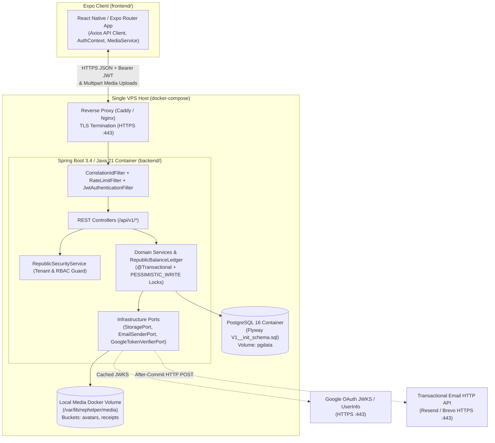
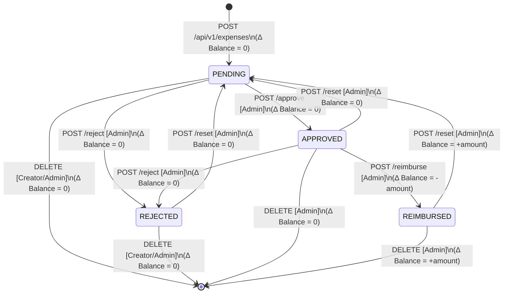

# RepHelper Monorepo & Backend Architecture (Java 21 + Spring Boot 3.4 + PostgreSQL 16 on VPS)

*   **Author:** leosaponisouza
*   **Status:** Proposed
*   **Date:** 2026-11-19

--------------------------------------------------------------------------------

## Overview

RepHelper is a mobile and web application built with React Native and Expo for managing shared student residences ("repúblicas" — collective student housing where residents split rent, utilities, groceries, and household chores). The application covers six core operational areas: resident and household administration, recurring household chores, shared expenses and incomes, financial dashboards, household events with attendance tracking, and in-app notifications.

This design document specifies the reorganization of the existing repository (`c:\Users\Admin\rep-helper-frontend`) into a single `rep-helper` monorepo (`frontend/`, `backend/`, `docs/`, and root `docker-compose.yml`) and the implementation of a self-hosted Java 21, Spring Boot 3.4, and PostgreSQL 16 backend designed to run on a single Virtual Private Server (VPS). It also specifies the targeted refactoring of the Expo client to eliminate external Backend-as-a-Service (BaaS) dependencies (Firebase Authentication and Supabase Storage) in favor of internal JWT authentication and local VPS volume media storage.

### Heilmeier Framing

*   **Objectives (No Jargon):** Unify the RepHelper project into one repository containing both the mobile/web app (`frontend/`) and a new Java + PostgreSQL server (`backend/`), so a student household can run the entire system on a single low-cost VPS without paying for or relying on Firebase or Supabase.
*   **State of the Art & Current Limits:** Today, the repository only contains the Expo client code at the root directory and an incompatible academic specification in `docs/arquitetura-e-modelagem/*`. The client code suffers from three critical defects:
    1.  **Broken Cross-Provider Security:** The client logs users in with Firebase Auth (`src/services/authService.ts`) but uploads avatars and receipts to Supabase Storage (`src/services/supabase.ts`) using only an unauthenticated public anonymous key (`EXPO_PUBLIC_SUPABASE_ANON_KEY`). Because Supabase cannot verify Firebase sessions without custom token bridging, bucket policies must either allow anonymous writes/deletes (allowing any user to overwrite or delete another user's files) or reject uploads entirely.
    2.  **Split-Brain Session State:** Screens such as `app/(republic)/choice.tsx` and `src/services/republicService.ts` mix Firebase's `onAuthStateChanged` and `getFreshFirebaseToken()` with the backend's own JWT stored in `src/services/api.ts`, causing authentication desynchronization when joining or creating a republic.
    3.  **Internal Frontend Contract Divergences:** Seven API call sites across `app/**` and `src/services/**` send or expect conflicting JSON shapes for the same endpoints (flat vs. nested `address`, `code` vs. `customCode`, `length` vs. `codeLength`, `uid` vs. `id`, `entryDate` vs. `joinedAt`, wrapped `{ user }` vs. flat `User`, and mixed ISO-8601 date strings with and without UTC `Z` offsets).
*   **New Approach:** Co-locate `frontend/` and `backend/` in a single Git monorepo (`rep-helper`), implement a modular Spring Boot 3.4 + PostgreSQL 16 API that matches the Expo client's `/api/v1/*` contract, replace Firebase Auth with internal Spring Security JWT + BCrypt + direct Google ID token verification + 6-digit password reset codes, replace Supabase Storage with a magic-byte-validated local Docker volume media service (`/api/v1/media/*`), and reconcile the 7 divergent frontend contracts.
*   **Impact:** Student households and maintainers gain a self-contained, single-command (`docker compose up -d`) production backend with deterministic financial balance accounting, zero external BaaS vulnerabilities, and synchronized frontend/backend contracts.
*   **Risks & Payoffs:**
    *   *Risk:* Concurrent expense reimbursements, resets, or manual adjustments corrupting `Republic.currentBalance`. *Mitigation:* Centralize balance mutations in a single ledger component guarded by PostgreSQL row-level pessimistic write locks (`SELECT ... FOR UPDATE`).
    *   *Risk:* Local VPS disk exhaustion from orphaned avatar and receipt uploads. *Mitigation:* Client-side 600px JPEG compression (~100 KB/image), backend 5 MB + 12-byte magic-number stream validation, and automatic deletion of superseded files on update/delete.
    *   *Risk:* VPS outbound port 25/587 blocks preventing password-reset emails. *Mitigation:* Dispatch 6-digit reset codes via an HTTPS transactional email API (port 443) after database transaction commit, with a local console log fallback in development.
*   **Cost (Compute & Infrastructure):** Designed to run within a single 1–2 vCPU, 2 GB–4 GB RAM VPS (~$5–$10/month) by capping JVM heap at 60% container allocation, enabling Java 21 virtual threads, sizing HikariCP to 10 connections, and pushing dashboard aggregations to indexed PostgreSQL queries.
*   **Timeline & Staging:** Executed in 5 sequential phases: (1) Monorepo restructuring (`git mv` into `frontend/`), (2) Backend Maven & Flyway PostgreSQL schema initialization in `backend/`, (3) Internal Auth & Media modules, (4) Core domain modules (`Users`, `Republics`, `Tasks`, `Finances`, `Events`, `Notifications`, `Health`), and (5) Frontend BaaS removal, contract unification, and `docs/` alignment.
*   **Metrics & Exams:**
    *   *Mid-term Exam:* Flyway migration `V1__init_schema.sql` applies cleanly on PostgreSQL 16, and Spring Boot context + OpenAPI specification (`/v3/api-docs`) start with `GET /api/v1/health` returning `200 OK`.
    *   *Final Exam:* All backend JUnit 5 integration tests (`mvn test`), frontend TypeScript compilation (`npm run typecheck`), and frontend Jest test suites (`npm run test:ci`) pass with zero Firebase or Supabase runtime dependencies.

--------------------------------------------------------------------------------

## The Problem

The RepHelper frontend is fully built in React Native / Expo, but it cannot operate as a production system for four reasons:

1.  **Missing Production Backend & Outdated Documentation:** There is no backend implementation in the repository. Meanwhile, `docs/arquitetura-e-modelagem/*` describes an incompatible system with Portuguese endpoints (`/api/v1/republicas`, `/api/v1/financeiro`, `/api/v1/materiais`, `/api/v1/votacoes`), UUID keys for all tables, and domain concepts not present in the mobile app, whereas the actual app calls English endpoints (`/api/v1/auth/*`, `/api/v1/users/*`, `/api/v1/republics/*`, `/api/v1/tasks/*`, `/api/v1/expenses/*`, `/api/v1/incomes/*`, `/api/v1/financial-dashboard/*`, `/api/v1/finances/*`, `/api/v1/events/*`, `/api/v1/notifications/*`, `/api/v1/health`) and enforces positive integer IDs (`validatePositiveIntId` in `src/utils/urlSecurity.ts`) for tasks, expenses, incomes, events, and notifications.
2.  **Unsafe Dual-BaaS Dependency (Firebase Auth + Supabase Storage):** The app authenticates with Firebase Auth but uploads images to Supabase Storage using an unauthenticated anonymous client. Furthermore, Firebase Cloud Storage requires a Blaze pay-as-you-go billing account, and maintaining two external cloud services alongside a VPS adds operational fragility and dual-token bugs (e.g., `republicService.joinRepublic` overwriting the API JWT with a Firebase ID token, and `app/(republic)/choice.tsx` blocking republic join if `firebaseUser` is null).
3.  **Contradictory Frontend Payload Contracts:** Seven endpoints have mismatched request or response shapes between `src/services/*`, `src/models/*`, and direct `api.*` calls in `app/**` (including `app/(republic)/new.tsx` failing to update `user.currentRepublicId` and `user.isAdmin` in `AuthContext` after creating a republic, and `app/(panel)/tasks/edit.tsx` only adding assignees via `/assign` without ever unassigning deselected users).
4.  **Unbounded Financial & Recurrence Edge Cases:** The frontend relies on the backend to maintain `Republic.currentBalance` across income CRUD, manual balance adjustments (`POST /api/v1/finances/{republicId}/adjust-balance`, which sends a target balance in `amount`), and expense status transitions (`PENDING`, `APPROVED`, `REJECTED`, `REIMBURSED`, plus `reset` and `delete`), as well as atomic generation of the next `PENDING` task instance when a recurring task is completed (`POST /api/v1/tasks/{id}/complete`).

**Proposed Solution:** Reorganize the repository into a `rep-helper` monorepo (`frontend/` + `backend/` + `docs/` + `docker-compose.yml`), implement the Java 21 + Spring Boot 3.4 + PostgreSQL 16 backend with 100% internal authentication and local Docker volume media storage, unify the divergent frontend contracts while removing Firebase and Supabase SDKs, and update `docs/arquitetura-e-modelagem/*` to match the real architecture.

--------------------------------------------------------------------------------

## Goals

*   **G1 — Monorepo Restructuring (Step 1 of Implementation):** Move all existing React Native / Expo files into `frontend/` via `git mv`, create the Spring Boot 3.4 / Java 21 project under `backend/`, keep shared documentation under `docs/`, and provide a root `docker-compose.yml` for single-VPS deployment.
*   **G2 — 100% Internal Authentication (Zero Firebase):** Implement `/api/v1/auth/signup`, `/api/v1/auth/login`, `/api/v1/auth/google`, `/api/v1/auth/refresh`, `/api/v1/auth/logout`, `/api/v1/auth/change-password`, `/api/v1/auth/forgot-password`, and `/api/v1/auth/reset-password` using Spring Security 6, `BCrypt`, signed JWT access tokens, rotating refresh tokens, local Google JWKS ID token verification (with `accessToken` fallback), and a 6-digit password reset code sent via an HTTPS transactional email adapter (with a console log fallback in `dev`).
*   **G3 — Internal VPS Media Storage (Zero Supabase):** Implement `POST /api/v1/media/{bucket}` (`multipart/form-data`), `DELETE /api/v1/media/{bucket}/{filename}`, and `GET /api/v1/media/public/{bucket}/{userId}/{filename}` for the `avatars` and `receipts` buckets, enforcing a 5 MB limit, 12-byte magic-number validation (`JPEG`, `PNG`, `WebP`, `GIF`), ownership checks (`authenticatedUser.uid == userId`), immutable cache headers, and automatic deletion of superseded files on disk.
*   **G4 — Complete Domain API & Strict Invariants:** Implement all `/api/v1` endpoints for `users`, `republics`, `tasks` (dynamic filtering, pagination, atomic assignee reconciliation, and atomic recurring task generation on completion), `expenses`, `incomes`, `financial-dashboard`, `finances` (pessimistic-locked `RepublicBalanceLedger` enforcing exact balance deltas across all state transitions), `events`, `notifications`, and `health`.
*   **G5 — Frontend BaaS Removal & Contract Unification:** Remove `firebase` and `@supabase/supabase-js` from `frontend/`, wire internal auth and media services, resolve all 7 frontend contract discrepancies, and maintain 100% passing TypeScript checks (`npm run typecheck`) and Jest tests (`npm run test:ci`).
*   **G6 — Documentation Synchronization:** Rewrite `docs/arquitetura-e-modelagem/*` so the architecture overview, REST API specification, data model, Flyway PostgreSQL schema, state/sequence diagrams, and infrastructure setup match the implemented monorepo.

## Non-Goals

*   **NG1 — Push Notification Broker (FCM / APNs / Expo Push):** Outbound OS push notification delivery is out of scope; notifications remain in-app via `/api/v1/notifications/*` polled by `useNotifications.ts`.
*   **NG2 — External Banking or PIX Gateway Integration:** Expense approvals, reimbursements, incomes, and balance adjustments operate as an internal accounting ledger without executing real-money bank transfers.
*   **NG3 — Multi-Node Cloud Orchestration or External Object Storage:** Kubernetes, microservices, AWS S3, Cloudflare R2, and CDN clusters are out of scope; deployment targets a single VPS running Docker Compose with persistent volumes.
*   **NG4 — Unrelated Domain Modules from Legacy Docs:** Modules present only in the legacy `docs/` files (such as `materiais/estoque`, `problemas no imóvel`, `votações/enquetes`, and monthly gamification rankings) are excluded because they do not exist in the source-of-truth Expo application.

## Open Questions

*   None — all architectural choices, authentication and media storage mechanisms, monorepo structure, and domain invariants were resolved during `egm-brainstorm`.

--------------------------------------------------------------------------------

## Critical User Journeys (CUJs)

### CUJ 1: Internal Registration, Login, Google OAuth, and 6-Digit Password Reset

*   **Given**: A user on the Expo app (`frontend/`) with no active session and the Spring Boot backend (`backend/`) running with PostgreSQL 16.
*   **When**:
    1.  The user registers via `POST /api/v1/auth/signup` with `{ name, nickname, email, phoneNumber, password }`, or logs in via `POST /api/v1/auth/login` with `{ email, password }`, or signs in with Google via `POST /api/v1/auth/google` with `{ idToken, accessToken }`.
    2.  Or, if the user forgot their password, they request a reset code via `POST /api/v1/auth/forgot-password` (`{ email }`) and submit the 6-digit code and new password on `frontend/app/(auth)/forgot-password.tsx` via `POST /api/v1/auth/reset-password` (`{ email, code, newPassword }`).
*   **Then**:
    1.  For signup/login/Google OAuth, the backend hashes/verifies credentials (linking Google identity by verified email if an account already exists), persists a hashed refresh token, and returns `{ token, refreshToken, user }` where `user.uid` is the user's UUID string.
    2.  For password reset, the backend returns a generic `200 OK` on `/forgot-password` (preventing email enumeration), dispatches the 15-minute 6-digit code post-commit via `EmailSenderPort`, and upon `/reset-password` updates `password_hash`, revokes all existing refresh tokens for that user, and marks the reset token as used.

### CUJ 2: Republic Creation, Invite Code Management, and Joining with Immediate Session Sync

*   **Given**: An authenticated user without an active republic (`currentRepublicId == null`) on `frontend/app/(republic)/choice.tsx` (which verifies backend connectivity via `GET /api/v1/health`).
*   **When**:
    1.  User A creates a republic via `POST /api/v1/republics` on `frontend/app/(republic)/new.tsx`.
    2.  User B enters the republic's invite code on `frontend/app/(republic)/choice.tsx` (`POST /api/v1/republics/join` with `{ code }`).
    3.  User A updates republic address details (`PUT /api/v1/republics/{id}`) or regenerates a random/custom invite code (`POST /api/v1/republics/{id}/regenerate-code`) on `frontend/app/(panel)/settings/republic.tsx`.
*   **Then**:
    1.  Creating the republic inserts the `republics` row (with a unique 6-char uppercase alphanumeric `code` and `current_balance = 0.00`) and a `republic_members` row (`is_admin = true`, `is_owner = true`, `status = 'ACTIVE'`), updates User A's `current_republic_id`, returns `{ republic, user, token, message }`, and updates `AuthContext` so User A immediately lands on `/(panel)/home` as Admin.
    2.  Joining via `/api/v1/republics/join` authenticates using User B's standard backend JWT (no Firebase token), links User B as an `ACTIVE` non-admin member, updates User B's `current_republic_id`, and returns `{ token, user, republic }`.

### CUJ 3: Task Creation, Assignee Reconciliation on Edit, and Atomic Recurring Task Generation

*   **Given**: An authenticated member of an active republic viewing `frontend/app/(panel)/tasks/`.
*   **When**:
    1.  The member creates a recurring task (`POST /api/v1/tasks` with `recurring: true`, `recurrenceType: 'WEEKLY'`, `recurrenceInterval: 1`, `dueDate`, and `assigned_users: [uid1, uid2]`).
    2.  The member edits the task (`PUT /api/v1/tasks/{id}`) and removes `uid2` from the selected assignees.
    3.  An assigned member completes the task (`POST /api/v1/tasks/{id}/complete`).
*   **Then**:
    1.  Task creation atomically persists the task and its `task_assignees` join rows in one transaction and creates in-app notifications for assigned members.
    2.  Task editing reconciles the complete `task_assignees` set (removing `uid2` and keeping `uid1`) without requiring separate `/unassign` calls.
    3.  Completing the task acquires a `PESSIMISTIC_WRITE` lock on the task row, transitions status from `PENDING | IN_PROGRESS | OVERDUE -> COMPLETED` (`completedAt = now()`), and atomically inserts the next `PENDING` task instance with `dueDate = previousDueDate + 1 week` (if within `recurrenceEndDate`), copying `assignedUsers` and setting `parentTaskId = completedTask.id`.

### CUJ 4: Expense Receipt Upload to VPS Volume, Approval, Locked Reimbursement, and Reversal

*   **Given**: An authenticated member and an Admin in an active republic whose `currentBalance` is `R$ 1000,00`.
*   **When**:
    1.  The member selects a receipt photo on `frontend/app/(panel)/finances/expenses/create.tsx` (compressed client-side to 600px JPEG), which uploads via `POST /api/v1/media/receipts`, and submits `POST /api/v1/expenses` for `R$ 150,00` with the returned `receiptUrl`.
    2.  The Admin approves the expense (`POST /api/v1/expenses/{id}/approve`) and then marks it as reimbursed (`POST /api/v1/expenses/{id}/reimburse`).
    3.  Later, the Admin resets the reimbursed expense (`POST /api/v1/expenses/{id}/reset`) or deletes it (`DELETE /api/v1/expenses/{id}`).
*   **Then**:
    1.  The media endpoint verifies the JPEG magic bytes and 5 MB limit, writes `/var/lib/rephelper/media/receipts/{userId}/{uuid}.jpg`, and returns an absolute URL `https://<host>/api/v1/media/public/receipts/{userId}/{uuid}.jpg` that renders directly in React Native `<Image>`.
    2.  While `PENDING` or `APPROVED`, `Republic.currentBalance` remains `R$ 1000,00` (reflected in `pendingExpensesAmount` and `approvedExpensesAmount` on `GET /api/v1/financial-dashboard/summary/{republicId}`).
    3.  Upon `POST /api/v1/expenses/{id}/reimburse`, `RepublicBalanceLedger` locks the `Republic` row (`PESSIMISTIC_WRITE`), transitions the expense to `REIMBURSED`, and deducts `R$ 150,00`, updating `currentBalance` to `R$ 850,00`.
    4.  Upon `reset` (back to `PENDING`) or `delete` from `REIMBURSED`, `RepublicBalanceLedger` locks the `Republic` row and refunds `+R$ 150,00`, restoring `currentBalance` to `R$ 1000,00` (and unlinking the receipt file on `delete`).

### CUJ 5: Event Creation, Invitations, and In-App Notifications

*   **Given**: An authenticated member in an active republic.
*   **When**: The member creates a household event (`POST /api/v1/events`) and invites residents (`POST /api/v1/events/{id}/invite` with `{ userIds }`), and an invited resident responds (`PUT /api/v1/events/{id}/respond` with `{ status: 'CONFIRMED' }`).
*   **Then**: The backend persists the event (inferring `republicId` from the authenticated user if omitted on list queries `GET /api/v1/events`, `/upcoming`, `/invited`, `/confirmed`), records `EventInvitation` rows, generates in-app notifications (`GET /api/v1/notifications`, `/unread`, `/count`) for invitees and the event creator, and computes `isHappening` and `isFinished` dynamically relative to the current timestamp.

--------------------------------------------------------------------------------

## Technical Plan (Architecture)

### 1. Monorepo & Deployment Topology

The repository is structured as a single `rep-helper` monorepo containing the React Native / Expo client (`frontend/`), the Spring Boot 3.4 API (`backend/`), shared architectural documentation (`docs/`), and root Docker Compose files (`docker-compose.yml` for local development and `docker-compose.prod.yml` for single-VPS deployment).



```text
rep-helper/
├── docker-compose.yml                  # Local & VPS container orchestration (postgres + backend)
├── .env.example                        # Root environment template for Docker Compose
├── README.md                           # Monorepo quickstart and architecture index
├── docs/
│   ├── arquitetura-e-modelagem/        # Updated architecture, REST spec, ER model, Flyway DDL
│   └── designs/                        # EGM design documents
├── frontend/                           # React Native / Expo app (moved from root via git mv)
│   ├── app/
│   ├── components/
│   ├── src/
│   ├── assets/
│   ├── android/
│   ├── package.json
│   └── tsconfig.json
└── backend/                            # Java 21 + Spring Boot 3.4 Maven project
    ├── pom.xml
    ├── Dockerfile
    └── src/
        ├── main/
        │   ├── java/com/rephelper/backend/
        │   │   ├── RepHelperApplication.java
        │   │   ├── config/             # SecurityConfig, JacksonConfig, CorsConfig, OpenApiConfig
        │   │   ├── common/             # GlobalExceptionHandler, ApiErrorResponse, CorrelationIdFilter, HealthController
        │   │   ├── auth/               # AuthController, AuthService, JwtService, GoogleOAuthVerifier, EmailSenderPort
        │   │   ├── user/               # UserController, UserService, User, UserRepository
        │   │   ├── republic/           # RepublicController, RepublicService, RepublicSecurityService, Republic, RepublicMember
        │   │   ├── task/               # TaskController, TaskService, TaskSpecifications, Task, TaskRepository
        │   │   ├── finance/            # ExpenseController, IncomeController, FinancialDashboardController, RepublicFinanceController, RepublicBalanceLedger
        │   │   ├── event/              # EventController, EventService, Event, EventInvitation
        │   │   ├── notification/       # NotificationController, NotificationService, Notification
        │   │   └── media/              # MediaController, MediaStorageService, StoragePort, LocalFileSystemStorageAdapter, ImageMagicByteValidator
        │   └── resources/
        │       ├── application.yml
        │       └── db/migration/
        │           └── V1__init_schema.sql
        └── test/
            └── java/com/rephelper/backend/
```

---

### 2. PostgreSQL 16 Database Schema (`V1__init_schema.sql`)

To maintain strict compatibility with `frontend/src/utils/urlSecurity.ts` (`validatePositiveIntId` for tasks, expenses, incomes, and events; `encodePathSegment` for UUID user and republic IDs) and `frontend/src/services/supabase.ts` (`SAFE_USER_ID_REGEX`), the schema uses `UUID` primary keys for `users` and `republics`, and `BIGINT GENERATED BY DEFAULT AS IDENTITY` primary keys for all other domain entities:

*   **`users`**:
    *   `uid UUID PRIMARY KEY DEFAULT gen_random_uuid()`
    *   `name VARCHAR(120) NOT NULL`
    *   `nickname VARCHAR(60)`
    *   `email VARCHAR(150) NOT NULL UNIQUE`
    *   `phone_number VARCHAR(30)`
    *   `profile_picture_url VARCHAR(500)`
    *   `password_hash VARCHAR(255)` (nullable for Google-only accounts until password set)
    *   `provider VARCHAR(30) NOT NULL DEFAULT 'email'` (`'email'`, `'google.com'`)
    *   `firebase_uid VARCHAR(128)` (populated with `uid::text` or Google `sub` for backward compatibility with `User.firebaseUid` in `frontend/src/models/user.model.ts`)
    *   `current_republic_id UUID` (FK to `republics(id) ON DELETE SET NULL`)
    *   `status VARCHAR(20) NOT NULL DEFAULT 'active' CHECK (status IN ('active', 'inactive', 'banned'))`
    *   `created_at TIMESTAMPTZ NOT NULL DEFAULT CURRENT_TIMESTAMP`
    *   `last_login TIMESTAMPTZ`
*   **`republics`**:
    *   `id UUID PRIMARY KEY DEFAULT gen_random_uuid()`
    *   `name VARCHAR(120) NOT NULL`
    *   `code VARCHAR(16) NOT NULL UNIQUE`
    *   `street VARCHAR(200) NOT NULL`, `number VARCHAR(30) NOT NULL`, `complement VARCHAR(100)`, `neighborhood VARCHAR(120) NOT NULL`, `city VARCHAR(120) NOT NULL`, `state VARCHAR(2) NOT NULL`, `zip_code VARCHAR(20) NOT NULL`
    *   `owner_id UUID NOT NULL REFERENCES users(uid) ON DELETE RESTRICT`
    *   `current_balance NUMERIC(14, 2) NOT NULL DEFAULT 0.00`
    *   `created_at TIMESTAMPTZ NOT NULL DEFAULT CURRENT_TIMESTAMP`
    *   `updated_at TIMESTAMPTZ NOT NULL DEFAULT CURRENT_TIMESTAMP`
*   **`republic_members`**:
    *   `id UUID PRIMARY KEY DEFAULT gen_random_uuid()`
    *   `republic_id UUID NOT NULL REFERENCES republics(id) ON DELETE CASCADE`
    *   `user_id UUID NOT NULL REFERENCES users(uid) ON DELETE CASCADE`
    *   `is_admin BOOLEAN NOT NULL DEFAULT FALSE`
    *   `is_owner BOOLEAN NOT NULL DEFAULT FALSE`
    *   `status VARCHAR(20) NOT NULL DEFAULT 'ACTIVE' CHECK (status IN ('ACTIVE', 'INACTIVE', 'PENDING', 'BANNED'))`
    *   `joined_at TIMESTAMPTZ NOT NULL DEFAULT CURRENT_TIMESTAMP`
    *   `UNIQUE (republic_id, user_id)`
*   **`refresh_tokens`**:
    *   `id BIGINT GENERATED BY DEFAULT AS IDENTITY PRIMARY KEY`
    *   `user_uid UUID NOT NULL REFERENCES users(uid) ON DELETE CASCADE`
    *   `token_hash VARCHAR(64) NOT NULL UNIQUE` (SHA-256 hex digest)
    *   `expires_at TIMESTAMPTZ NOT NULL`
    *   `revoked BOOLEAN NOT NULL DEFAULT FALSE`
    *   `created_at TIMESTAMPTZ NOT NULL DEFAULT CURRENT_TIMESTAMP`
*   **`password_reset_tokens`**:
    *   `id BIGINT GENERATED BY DEFAULT AS IDENTITY PRIMARY KEY`
    *   `user_uid UUID NOT NULL REFERENCES users(uid) ON DELETE CASCADE`
    *   `code_hash VARCHAR(64) NOT NULL` (SHA-256 hash of 6-digit code)
    *   `expires_at TIMESTAMPTZ NOT NULL`
    *   `used BOOLEAN NOT NULL DEFAULT FALSE`
    *   `attempts INTEGER NOT NULL DEFAULT 0`
    *   `created_at TIMESTAMPTZ NOT NULL DEFAULT CURRENT_TIMESTAMP`
*   **`tasks`** & **`task_assignees`**:
    *   `tasks`: `id BIGINT GENERATED BY DEFAULT AS IDENTITY PRIMARY KEY`, `republic_id UUID NOT NULL REFERENCES republics(id) ON DELETE CASCADE`, `title VARCHAR(200) NOT NULL`, `description TEXT`, `due_date TIMESTAMPTZ`, `category VARCHAR(80)`, `status VARCHAR(20) NOT NULL DEFAULT 'PENDING' CHECK (status IN ('PENDING', 'IN_PROGRESS', 'COMPLETED', 'OVERDUE', 'CANCELLED'))`, `created_by_uid UUID REFERENCES users(uid) ON DELETE SET NULL`, `recurring BOOLEAN NOT NULL DEFAULT FALSE`, `recurrence_type VARCHAR(20) CHECK (recurrence_type IN ('DAILY', 'WEEKLY', 'MONTHLY', 'YEARLY'))`, `recurrence_interval INTEGER DEFAULT 1`, `recurrence_end_date TIMESTAMPTZ`, `parent_task_id BIGINT REFERENCES tasks(id) ON DELETE SET NULL`, `completed_at TIMESTAMPTZ`, `created_at TIMESTAMPTZ NOT NULL DEFAULT CURRENT_TIMESTAMP`, `updated_at TIMESTAMPTZ NOT NULL DEFAULT CURRENT_TIMESTAMP`.
    *   `task_assignees`: `task_id BIGINT NOT NULL REFERENCES tasks(id) ON DELETE CASCADE`, `user_uid UUID NOT NULL REFERENCES users(uid) ON DELETE CASCADE`, `PRIMARY KEY (task_id, user_uid)`.
*   **`expenses`**, **`incomes`**, & **`balance_adjustments`**:
    *   `expenses`: `id BIGINT GENERATED BY DEFAULT AS IDENTITY PRIMARY KEY`, `republic_id UUID NOT NULL REFERENCES republics(id) ON DELETE CASCADE`, `creator_uid UUID NOT NULL REFERENCES users(uid) ON DELETE RESTRICT`, `description VARCHAR(255) NOT NULL`, `amount NUMERIC(14, 2) NOT NULL CHECK (amount > 0)`, `expense_date TIMESTAMPTZ NOT NULL`, `category VARCHAR(80) NOT NULL`, `status VARCHAR(20) NOT NULL DEFAULT 'PENDING' CHECK (status IN ('PENDING', 'APPROVED', 'REJECTED', 'REIMBURSED'))`, `receipt_url VARCHAR(500)`, `notes TEXT`, `approver_uid UUID REFERENCES users(uid) ON DELETE SET NULL`, `approval_date TIMESTAMPTZ`, `reimbursement_date TIMESTAMPTZ`, `rejection_reason VARCHAR(500)`, `created_at TIMESTAMPTZ NOT NULL DEFAULT CURRENT_TIMESTAMP`, `updated_at TIMESTAMPTZ NOT NULL DEFAULT CURRENT_TIMESTAMP`.
    *   `incomes`: `id BIGINT GENERATED BY DEFAULT AS IDENTITY PRIMARY KEY`, `republic_id UUID NOT NULL REFERENCES republics(id) ON DELETE CASCADE`, `creator_uid UUID NOT NULL REFERENCES users(uid) ON DELETE RESTRICT`, `contributor_uid UUID REFERENCES users(uid) ON DELETE SET NULL`, `description VARCHAR(255) NOT NULL`, `amount NUMERIC(14, 2) NOT NULL CHECK (amount > 0)`, `income_date TIMESTAMPTZ NOT NULL`, `source VARCHAR(100) NOT NULL`, `receipt_url VARCHAR(500)`, `notes TEXT`, `created_at TIMESTAMPTZ NOT NULL DEFAULT CURRENT_TIMESTAMP`, `updated_at TIMESTAMPTZ NOT NULL DEFAULT CURRENT_TIMESTAMP`.
    *   `balance_adjustments`: `id BIGINT GENERATED BY DEFAULT AS IDENTITY PRIMARY KEY`, `republic_id UUID NOT NULL REFERENCES republics(id) ON DELETE CASCADE`, `actor_uid UUID NOT NULL REFERENCES users(uid) ON DELETE RESTRICT`, `previous_balance NUMERIC(14, 2) NOT NULL`, `new_balance NUMERIC(14, 2) NOT NULL`, `delta NUMERIC(14, 2) NOT NULL`, `description VARCHAR(300)`, `created_at TIMESTAMPTZ NOT NULL DEFAULT CURRENT_TIMESTAMP`.
*   **`events`** & **`event_invitations`**:
    *   `events`: `id BIGINT GENERATED BY DEFAULT AS IDENTITY PRIMARY KEY`, `republic_id UUID NOT NULL REFERENCES republics(id) ON DELETE CASCADE`, `creator_uid UUID NOT NULL REFERENCES users(uid) ON DELETE RESTRICT`, `title VARCHAR(180) NOT NULL`, `description TEXT NOT NULL`, `start_date TIMESTAMPTZ NOT NULL`, `end_date TIMESTAMPTZ NOT NULL`, `location VARCHAR(255) NOT NULL`, `created_at TIMESTAMPTZ NOT NULL DEFAULT CURRENT_TIMESTAMP`, `CHECK (end_date > start_date)`.
    *   `event_invitations`: `event_id BIGINT NOT NULL REFERENCES events(id) ON DELETE CASCADE`, `user_uid UUID NOT NULL REFERENCES users(uid) ON DELETE CASCADE`, `status VARCHAR(20) NOT NULL DEFAULT 'INVITED' CHECK (status IN ('INVITED', 'CONFIRMED', 'DECLINED'))`, `responded_at TIMESTAMPTZ`, `PRIMARY KEY (event_id, user_uid)`.
*   **`notifications`**:
    *   `id BIGINT GENERATED BY DEFAULT AS IDENTITY PRIMARY KEY`, `recipient_uid UUID NOT NULL REFERENCES users(uid) ON DELETE CASCADE`, `republic_id UUID REFERENCES republics(id) ON DELETE CASCADE`, `title VARCHAR(180) NOT NULL`, `message TEXT NOT NULL`, `type VARCHAR(50) NOT NULL`, `entity_type VARCHAR(50)`, `entity_id VARCHAR(100)`, `read BOOLEAN NOT NULL DEFAULT FALSE`, `created_at TIMESTAMPTZ NOT NULL DEFAULT CURRENT_TIMESTAMP`.

---

### 3. Complete REST API Specification & Contract Unification Matrix

#### 3.1 Endpoint Map (`/api/v1`)

| Module | Method & Path | Auth / Role | Request Contract | Response Contract |
| :--- | :--- | :--- | :--- | :--- |
| **Health** | `GET /api/v1/health` | Public | None | `{ "status": "UP", "database": "UP", "storage": "UP" }` |
| **Auth** | `POST /api/v1/auth/signup` | Public | `{ name, nickname?, email, phoneNumber?, profilePictureUrl?, password }` | `AuthResponse { token, refreshToken, user }` |
| **Auth** | `POST /api/v1/auth/login` | Public | `{ email, password }` | `AuthResponse { token, refreshToken, user }` |
| **Auth** | `POST /api/v1/auth/google` | Public | `{ idToken?, accessToken? }` | `AuthResponse { token, refreshToken, user }` |
| **Auth** | `POST /api/v1/auth/refresh` | Public | `{ refreshToken?, token? }` (`@JsonAlias`) | `AuthResponse { token, refreshToken, user }` |
| **Auth** | `POST /api/v1/auth/logout` | Authenticated | `{ refreshToken? }` (optional) | `204 No Content` |
| **Auth** | `POST /api/v1/auth/change-password` | Authenticated | `{ currentPassword, newPassword }` | `{ "message": "Senha alterada com sucesso." }` |
| **Auth** | `POST /api/v1/auth/forgot-password` | Public | `{ email }` | `{ "message": "Se existir uma conta associada a este email, enviaremos um código de redefinição de senha." }` |
| **Auth** | `POST /api/v1/auth/reset-password` | Public | `{ email, code, newPassword }` | `{ "message": "Senha redefinida com sucesso." }` |
| **Users** | `GET /api/v1/users/me` | Authenticated | None | `{ "user": UserDTO }` |
| **Users** | `PUT /api/v1/users/{uid}` | Authenticated (`self`) | `{ name?, nickname?, phoneNumber?, profilePictureUrl? }` | `UserDTO` (top-level object + old avatar deleted if replaced/removed) |
| **Republics** | `POST /api/v1/republics` | Authenticated | `{ name, street, number, complement?, neighborhood, city, state, zipCode (@JsonAlias "zip_code") }` | `{ republic: RepublicDTO, user: UserDTO, token: string, message: string }` |
| **Republics** | `GET /api/v1/republics/{id}` | Republic Member | None | `RepublicDTO` (with nested `address: { ..., fullAddress }`) |
| **Republics** | `PUT /api/v1/republics/{id}` | Republic Owner/Admin | Accepts flat fields OR nested `address: { ... }` | `RepublicDTO` |
| **Republics** | `POST /api/v1/republics/join` | Authenticated | `{ code }` | `{ token, refreshToken, user: UserDTO, republic: RepublicDTO, message }` |
| **Republics** | `GET /api/v1/republics/{id}/members` | Republic Member | None | `RepublicMemberDTO[]` (includes both `id` & `uid`, `joinedAt` & `entryDate`) |
| **Republics** | `POST /api/v1/republics/{id}/members/{memberId}/admin` | Republic Owner/Admin | None | `RepublicMemberDTO` |
| **Republics** | `DELETE /api/v1/republics/{id}/members/{memberId}/admin` | Republic Owner | None | `RepublicMemberDTO` |
| **Republics** | `DELETE /api/v1/republics/{id}/members/{memberId}` | Republic Owner/Admin or Self | None | `{ "message": "Membro removido com sucesso." }` |
| **Republics** | `POST /api/v1/republics/{id}/regenerate-code` | Republic Owner/Admin | `{ customCode? (@JsonAlias "code") }` | `{ code: string, message: string }` |
| **Republics** | `GET /api/v1/republics/code-length` | Authenticated | None | `{ length: 6, codeLength: 6 }` |
| **Tasks** | `GET /api/v1/tasks` | Republic Member | `?republicId=` (optional, defaults to `currentRepublicId`) | `TaskDTO[]` |
| **Tasks** | `POST /api/v1/tasks/filter` | Republic Member | `TaskFilterRequest` + `?republicId=` | `PagedResponse<TaskDTO>` |
| **Tasks** | `GET /api/v1/tasks/assigned` | Republic Member | None | `TaskDTO[]` |
| **Tasks** | `POST /api/v1/tasks/assigned/filter` | Republic Member | `TaskFilterRequest` | `PagedResponse<TaskDTO>` |
| **Tasks** | `GET /api/v1/tasks/{id}` | Republic Member | None | `TaskDTO` |
| **Tasks** | `POST /api/v1/tasks` | Republic Member | `CreateTaskDTO` (supports `assigned_users`, `recurring` / `isRecurring`) | `TaskDTO` |
| **Tasks** | `PUT /api/v1/tasks/{id}` | Republic Member | `UpdateTaskDTO` (if `assigned_users` present, atomically reconciles full assignee set) | `TaskDTO` |
| **Tasks** | `POST /api/v1/tasks/{id}/complete` | Republic Member | None | `TaskDTO` (atomically spawns next `PENDING` instance if `recurring == true`) |
| **Tasks** | `POST /api/v1/tasks/{id}/cancel` | Republic Member | None | `TaskDTO` |
| **Tasks** | `DELETE /api/v1/tasks/{id}` | Creator or Admin | None | `204 No Content` |
| **Tasks** | `POST /api/v1/tasks/{id}/assign` | Republic Member | `{ userId }` | `TaskDTO` |
| **Tasks** | `POST /api/v1/tasks/{id}/unassign` | Republic Member | `{ userId }` | `TaskDTO` |
| **Expenses** | `GET /api/v1/expenses` | Republic Member | `?republicId=` | `ExpenseDTO[]` |
| **Expenses** | `GET /api/v1/expenses/status/{status}` | Republic Member | `?republicId=` | `ExpenseDTO[]` |
| **Expenses** | `GET /api/v1/expenses/{id}` | Republic Member | None | `ExpenseDTO` |
| **Expenses** | `POST /api/v1/expenses` | Republic Member | `CreateExpenseRequest` | `ExpenseDTO` (`status = 'PENDING'`) |
| **Expenses** | `PUT /api/v1/expenses/{id}` | Creator or Admin | `UpdateExpenseRequest` (allowed in `PENDING` or `APPROVED`) | `ExpenseDTO` |
| **Expenses** | `POST /api/v1/expenses/{id}/approve` | Republic Admin | None | `ExpenseDTO` (`PENDING -> APPROVED`, balance delta `0`) |
| **Expenses** | `POST /api/v1/expenses/{id}/reject` | Republic Admin | `{ reason }` | `ExpenseDTO` (`PENDING|APPROVED -> REJECTED`, balance delta `0`) |
| **Expenses** | `POST /api/v1/expenses/{id}/reimburse` | Republic Admin | None | `ExpenseDTO` (`APPROVED -> REIMBURSED`, balance delta `-amount`) |
| **Expenses** | `POST /api/v1/expenses/{id}/reset` | Republic Admin | None | `ExpenseDTO` (`-> PENDING`, balance delta `+amount` if prior was `REIMBURSED`) |
| **Expenses** | `DELETE /api/v1/expenses/{id}` | Creator (`PENDING`/`REJECTED`) or Admin (any) | None | `204 No Content` (balance delta `+amount` if prior was `REIMBURSED`) |
| **Incomes** | `GET /api/v1/incomes` | Republic Member | `?republicId=` | `IncomeDTO[]` |
| **Incomes** | `GET /api/v1/incomes/{id}` | Republic Member | None | `IncomeDTO` |
| **Incomes** | `POST /api/v1/incomes` | Republic Member | `CreateIncomeRequest` | `IncomeDTO` (balance delta `+amount`) |
| **Incomes** | `PUT /api/v1/incomes/{id}` | Creator or Admin | `UpdateIncomeRequest` | `IncomeDTO` (balance delta `+(newAmount - oldAmount)`) |
| **Incomes** | `DELETE /api/v1/incomes/{id}` | Creator or Admin | None | `204 No Content` (balance delta `-oldAmount`) |
| **Finances** | `GET /api/v1/financial-dashboard/summary/{republicId}` | Republic Member | None | `FinancialDashboardSummaryDTO` |
| **Finances** | `GET /api/v1/financial-dashboard/expenses/monthly/{republicId}` | Republic Member | `?numberOfMonths=6` | `MonthlyChartDataDTO { monthlyData: [{ month: "yyyy-MM", expenses, incomes }] }` |
| **Finances** | `GET /api/v1/financial-dashboard/pending-actions/{republicId}` | Republic Member | None | `PendingActionsResponseDTO` |
| **Finances** | `POST /api/v1/finances/{republicId}/adjust-balance` | Republic Admin | `{ amount: targetNewBalance, description }` | `FinancialDashboardSummaryDTO` (sets `currentBalance = amount`) |
| **Events** | `GET /api/v1/events` | Republic Member | `?republicId=` (optional, defaults to `currentRepublicId`) | `EventDTO[]` |
| **Events** | `GET /api/v1/events/upcoming` | Republic Member | None | `EventDTO[]` (`endDate >= now()`) |
| **Events** | `GET /api/v1/events/invited` | Republic Member | None | `EventDTO[]` (current user invited with status `INVITED`) |
| **Events** | `GET /api/v1/events/confirmed` | Republic Member | None | `EventDTO[]` (current user status `CONFIRMED`) |
| **Events** | `GET /api/v1/events/{id}` | Republic Member | None | `EventDTO` |
| **Events** | `POST /api/v1/events` | Republic Member | `EventFormData` | `EventDTO` (creator auto-added as `CONFIRMED`) |
| **Events** | `PUT /api/v1/events/{id}` | Creator or Admin | `Partial<EventFormData>` | `EventDTO` |
| **Events** | `DELETE /api/v1/events/{id}` | Creator or Admin | None | `204 No Content` |
| **Events** | `POST /api/v1/events/{id}/invite` | Creator or Admin | `{ userIds: string[] }` | `EventDTO` |
| **Events** | `PUT /api/v1/events/{id}/respond` | Republic Member | `{ status: 'INVITED' \| 'CONFIRMED' \| 'DECLINED' }` | `EventDTO` |
| **Notifications** | `GET /api/v1/notifications` | Authenticated | None | `NotificationDTO[]` |
| **Notifications** | `GET /api/v1/notifications/unread` | Authenticated | None | `NotificationDTO[]` |
| **Notifications** | `GET /api/v1/notifications/count` | Authenticated | None | `{ count: number }` |
| **Notifications** | `GET /api/v1/notifications/{id}` | Recipient | None | `NotificationDTO` |
| **Notifications** | `POST /api/v1/notifications` | Republic Member | `CreateNotificationRequest` | `NotificationDTO` |
| **Notifications** | `POST /api/v1/notifications/{id}/read` | Recipient | None | `NotificationDTO` |
| **Notifications** | `POST /api/v1/notifications/mark-all-read` | Authenticated | None | `{ "updated": number }` |
| **Notifications** | `DELETE /api/v1/notifications/{id}` | Recipient | None | `204 No Content` |
| **Notifications** | `DELETE /api/v1/notifications/clear-old` | Authenticated | `?days=30` | `{ "deleted": number }` |
| **Media** | `POST /api/v1/media/{bucket}` | Authenticated | `multipart/form-data` (`file`) | `{ url: string, bucket: string, filename: string }` |
| **Media** | `DELETE /api/v1/media/{bucket}/{filename}` | Authenticated Owner | None | `204 No Content` |
| **Media** | `GET /api/v1/media/public/{bucket}/{userId}/{filename}` | Public (Capability UUID) | None | Binary image stream (`image/jpeg`, `image/png`, `image/webp`, `image/gif`) |

---

### 4. Financial Balance State Machine (`RepublicBalanceLedger`)

All mutations to `republics.current_balance` are funnelled through `RepublicBalanceLedger`, which acquires a PostgreSQL row lock (`@Lock(LockModeType.PESSIMISTIC_WRITE)` on `RepublicRepository.findByIdForUpdate(UUID id)`) before applying any transition:



---

### 5. Local VPS Media Storage & Security Flow

1.  **Client Compression & Upload (`frontend/src/services/supabase.ts`)**:
    *   To avoid touching unrelated component imports across tests and screens, `frontend/src/services/supabase.ts` retains its exported helper names (`uploadImageToSupabase`, `deleteImageFromSupabase`, `validateImageUploadUri`, `extractOwnedStoragePath`, `sanitizeStorageUserId`, `MAX_IMAGE_UPLOAD_BYTES`) while removing `@supabase/supabase-js` and sending `multipart/form-data` directly to `POST /api/v1/media/{bucket}` and `DELETE /api/v1/media/{bucket}/{filename}` via `api` (Axios with Bearer JWT).
2.  **Backend Stream Validation (`ImageMagicByteValidator` & `LocalFileSystemStorageAdapter`)**:
    *   Validates `bucket in ('avatars', 'receipts')` and `file.getSize() <= 5_242_880`.
    *   Reads the first 12 bytes from `file.getInputStream()` to verify magic numbers:
        *   `JPEG`: `FF D8 FF`
        *   `PNG`: `89 50 4E 47 0D 0A 1A 0A`
        *   `GIF`: `47 49 46 38 37 61` (`GIF87a`) or `47 49 46 38 39 61` (`GIF89a`)
        *   `WebP`: `52 49 46 46 .... 57 45 42 50` (`RIFF....WEBP`)
    *   Generates a server-side `UUID.randomUUID() + canonicalExtension`, resolves `/var/lib/rephelper/media/{bucket}/{authenticatedUser.uid}/{filename}`, verifies `targetPath.normalize().startsWith(rootPath)`, and writes atomically.
    *   Returns `{ url: "<APP_PUBLIC_BASE_URL>/api/v1/media/public/" + bucket + "/" + uid + "/" + filename }`.
    *   When `PUT /api/v1/users/{uid}` updates or clears `profilePictureUrl`, or when an `Expense` is updated with a new `receiptUrl` or deleted, `MediaStorageService.deleteIfOwnedByUrl(oldUrl)` removes the superseded file from disk.


--------------------------------------------------------------------------------

## Alternatives Considered

### Alternative A: Separate `rep-helper-frontend` and `rep-helper-backend` Git Repositories

*   **Pros**: Independent Git commit histories and separate CI pipelines for the mobile client and the Java API.
*   **Cons**: Creates an unverified cross-repository synchronization boundary where DTO field changes, enum renames, or documentation updates in one repository drift from the other; requires coordinating two repositories during local Docker Compose startup.
*   **Reason for Rejection**: Rejected by author: Consolidating into a single `rep-helper` monorepo with `frontend/` and `backend/` directories eliminates cross-repository contract drift and allows a single root `docker-compose.yml` and unified documentation tree.

### Alternative B: Keeping Firebase Auth + Supabase Storage Together (Current Frontend Setup)

*   **Pros**: Requires zero changes to the existing client authentication screens (`sign-in.tsx`, `sign-up.tsx`, `forgot-password.tsx`, `change-password.tsx`) or `src/services/supabase.ts`.
*   **Cons**: Because the client authenticates with Firebase Auth rather than Supabase Auth, `src/services/supabase.ts` initializes the Supabase client with only the public anonymous key (`EXPO_PUBLIC_SUPABASE_ANON_KEY`) and no authenticated Supabase session. Allowing direct client uploads and deletes requires opening Supabase Storage bucket policies to the `anon` role, enabling any party with the public anon key to overwrite or delete other users' files by spoofing `public/{userId}/...`. It also requires managing three separate platforms (Firebase, Supabase, and the VPS).
*   **Reason for Rejection**: Rejected by author: Exposes a security vulnerability because Supabase `anonKey` uploads and deletes cannot verify Firebase Auth sessions via Supabase RLS, and requires operating three separate infrastructures.

### Alternative C: Using Firebase Auth + Firebase Cloud Storage ("Only Firebase")

*   **Pros**: Unifies client authentication and image storage under a single Google Firebase SDK (`request.auth.uid == userId` in Firebase Storage rules) and delegates password-reset emails to Firebase.
*   **Cons**: Firebase Cloud Storage requires linking a credit card to the Blaze pay-as-you-go billing plan even when operating within free quota thresholds, and keeps the application coupled to external BaaS credentials and Firebase token verification (`firebase-admin` service account keys on the VPS).
*   **Reason for Rejection**: Rejected by author: Requires linking a credit card to the Firebase Blaze pay-as-you-go plan for Cloud Storage and keeps external BaaS lock-in instead of running self-contained on the VPS.

### Alternative D: Storing Images as `BYTEA` Blobs Inside PostgreSQL

*   **Pros**: Keeps all relational data and binary images inside a single PostgreSQL container without mounting a separate Docker volume for `/var/lib/rephelper/media`.
*   **Cons**: Multi-megabyte binary rows bloat PostgreSQL tables and `pg_dump` backups, increase shared buffer eviction pressure on a 2 GB–4 GB VPS, and tie up HikariCP database connections while streaming images to mobile clients.
*   **Reason for Rejection**: Rejected by author: Inflates PostgreSQL `pg_dump` backups and ties up HikariCP database connections during concurrent image uploads and downloads.

### Alternative E: Stateless-Only JWT Claims for `currentRepublicId` and `isAdmin`

*   **Pros**: Avoids querying the `users` and `republic_members` tables on authenticated requests by trusting `republicId` and `role` claims embedded in the JWT at login time.
*   **Cons**: When a user creates a republic (`POST /api/v1/republics`) or when a republic owner promotes, demotes, or removes another member asynchronously on a separate device, the target user's JWT claims remain stale until token expiration, allowing revoked admins or removed members to continue performing privileged actions.
*   **Reason for Rejection**: Rejected by author: Causes stale authorization state when a user creates a republic or when another admin promotes, demotes, or removes a member on a different device.

### Alternative F: Direct Outbound SMTP (Port 25 / 587) Inside `@Transactional` Methods

*   **Pros**: Uses standard `spring-boot-starter-mail` (`JavaMailSender`) over SMTP without an HTTP email adapter.
*   **Cons**: Cloud VPS providers routinely block outbound ports 25 and 587 at the hypervisor/network firewall to curb spam, and synchronous SMTP handshakes inside `@Transactional` methods hold HikariCP database connections open across external network timeouts.
*   **Reason for Rejection**: Rejected by author: Cloud VPS providers routinely block outbound port 25/587, and synchronous SMTP calls inside database transactions hold HikariCP connections open across network timeouts.

--------------------------------------------------------------------------------

## Non-Functional Requirements

*   **Security & Privacy**:
    *   Passwords are hashed using `BCryptPasswordEncoder` (strength 10). Refresh tokens and 6-digit password reset codes are stored as SHA-256 hex digests in PostgreSQL, never in plaintext.
    *   Multi-tenant isolation is enforced by `RepublicSecurityService` on every republic-scoped resource (`Task`, `Expense`, `Income`, `Event`, `RepublicMember`), preventing Horizontal/Vertical Insecure Direct Object Reference (IDOR) attacks.
    *   Media uploads inspect the first 12 magic bytes of the stream (`JPEG`, `PNG`, `WebP`, `GIF`), enforce a 5 MB ceiling, write to server-generated UUID filenames verified via `Path.normalize().startsWith(rootPath)`, and serve public files with `X-Content-Type-Options: nosniff`.
    *   In-memory sliding-window rate limiting guards `/api/v1/auth/*` (10 requests/minute/IP for login/forgot-password) and `/api/v1/media/*` (30 uploads/minute/user).
*   **Performance & Latency (Single-VPS Footprint)**:
    *   The backend container runs on Java 21 with virtual threads enabled (`spring.threads.virtual.enabled=true`), bounded heap (`-XX:MaxRAMPercentage=60.0`), and HikariCP `maximum-pool-size=10`, allowing PostgreSQL 16 and Spring Boot 3.4 to operate within a 2 GB RAM VPS.
    *   Financial dashboard endpoints (`/api/v1/financial-dashboard/*`) execute indexed SQL `SUM`/`GROUP BY` aggregations directly in PostgreSQL (`idx_expenses_republic_status_date`, `idx_incomes_republic_date`) rather than loading full entity lists into JVM memory.
*   **Rollout & Rollback**:
    *   Monorepo reorganization uses `git mv` so every moved frontend file retains its Git history and can be reverted cleanly with `git revert`.
    *   Database schema changes are versioned through Flyway (`V1__init_schema.sql`).
    *   VPS backups snapshot both the `pgdata` PostgreSQL volume (`pg_dump -Fc`) and the `media_data` volume (`/var/lib/rephelper/media`) together.

--------------------------------------------------------------------------------

### Additional Resources

*   [concepts_brief.md](file:///C:/Users/Admin/rep-helper-frontend/concepts_brief.md) — EGM Brainstorm Concepts Brief and 7-lens Goldfish synthesis.
*   [visao-geral-arquitetura.md](file:///C:/Users/Admin/rep-helper-frontend/docs/arquitetura-e-modelagem/visao-geral-arquitetura.md) — Legacy architecture overview to be updated in Phase 5.
*   [especificacao-api-rest.md](file:///C:/Users/Admin/rep-helper-frontend/docs/arquitetura-e-modelagem/especificacao-api-rest.md) — Legacy REST API specification to be updated in Phase 5.
*   [schema-postgresql-flyway.md](file:///C:/Users/Admin/rep-helper-frontend/docs/arquitetura-e-modelagem/schema-postgresql-flyway.md) — Legacy Flyway schema document to be updated in Phase 5.

### Future Improvements

*   **S3-Compatible Object Storage Adapter (`MinIO` / `Cloudflare R2`)**: If a future deployment scales beyond a single VPS node, implement an `S3StorageAdapter` for `StoragePort` without modifying domain or controller code.
*   **Expo Push Notification Adapter**: If background OS push notifications are desired later, add a `device_push_tokens` table and an `ExpoPushNotificationAdapter` triggered by `NotificationService` domain events.

--------------------------------------------------------------------------------

## Detailed Implementation Plan

### Phasing & Checkpoint Overview

1.  **Phase 1 — Monorepo Restructuring (`rep-helper/`)**: Move existing Expo application files from repository root into `./frontend/` via `git mv`, update root `.gitignore`, add root `docker-compose.yml`, `.env.example`, and `README.md`, and verify `./frontend` builds and passes tests from its new location.
2.  **Phase 2 — Backend Foundation, Common Infrastructure & Flyway Schema (`./backend/`)**: Create Maven configuration (`./backend/pom.xml`), `Dockerfile`, `application.yml`, `V1__init_schema.sql`, security and Jackson configuration, correlation filter, global exception handler, and `/api/v1/health`.
3.  **Phase 3 — Internal Authentication & Local VPS Media Modules (`./backend/`)**: Implement JWT creation/parsing, refresh token rotation, Google OAuth verification, 6-digit password reset code flow with `EmailSenderPort`, and `/api/v1/media/*` with 12-byte magic-number validation and local filesystem storage.
4.  **Phase 4 — Core Domain Modules (`./backend/`)**: Implement `user`, `republic` (including `RepublicSecurityService`), `task` (including dynamic specification filters, atomic assignee reconciliation, and recurring task generation), `finance` (including `RepublicBalanceLedger` with `PESSIMISTIC_WRITE`), `event`, `notification`, and backend JUnit 5 tests.
5.  **Phase 5 — Frontend Migration, Contract Unification & Documentation (`./frontend/` & `./docs/`)**: Remove Firebase Auth and Supabase Storage dependencies in `./frontend/`, wire internal `/api/v1/auth/*` and `/api/v1/media/*`, fix the 7 frontend contract divergences, update frontend unit tests, and update `./docs/arquitetura-e-modelagem/*`.

---

### Target Files to Create/Modify

#### Phase 1: Monorepo Restructuring & Root Orchestration

1.  `./frontend/` ([Move / Reorganize via `git mv`])
    *   **Type / Scope**: Expo / React Native Application Directory
    *   **Proposed Changes**: Move all existing frontend directories (`./app` -> `./frontend/app`, `./components` -> `./frontend/components`, `./src` -> `./frontend/src`, `./assets` -> `./frontend/assets`, `./android` -> `./frontend/android`) and frontend root configuration files (`./package.json` -> `./frontend/package.json`, `./package-lock.json` -> `./frontend/package-lock.json`, `./app.config.js` -> `./frontend/app.config.js`, `./app.json` -> `./frontend/app.json`, `./babel.config.js` -> `./frontend/babel.config.js`, `./eas.json` -> `./frontend/eas.json`, `./env.d.ts` -> `./frontend/env.d.ts`, `./env.js` -> `./frontend/env.js`, `./expo-env.d.ts` -> `./frontend/expo-env.d.ts`, `./jest.setup.js` -> `./frontend/jest.setup.js`, `./metro.config.js` -> `./frontend/metro.config.js`, `./tsconfig.json` -> `./frontend/tsconfig.json`, `./README-events-refactoring.md` -> `./frontend/README-events-refactoring.md`) into `./frontend/`. Rationale: Establishes the clean `frontend/` + `backend/` monorepo boundary requested as Step 1 while preserving Git history and keeping `@/*` path aliases in `./frontend/tsconfig.json` relative to `./frontend/`.
2.  `./.gitignore` ([Modify])
    *   **Type / Scope**: Git Configuration
    *   **Proposed Changes**: Update ignore rules to cover both `./frontend/` (`frontend/node_modules/`, `frontend/.expo/`, `frontend/dist/`) and `./backend/` (`backend/target/`, `.idea/`, `*.jar`, `media_data/`, `pgdata/`). Rationale: Prevents committing build artifacts, local media uploads, or IDE metadata from either subproject.
3.  `./docker-compose.yml` ([Create])
    *   **Type / Scope**: Container Orchestration
    *   **Proposed Changes**: Define `postgres` (`postgres:16-alpine`, port `5432`, healthcheck `pg_isready`, named volume `pgdata`) and `backend` (built from `./backend/Dockerfile`, port `8080`, depends on healthy `postgres`, named volume `media_data` mounted at `/var/lib/rephelper/media`, JVM flag `-XX:MaxRAMPercentage=60.0`, and environment variables for DB, JWT secret, public base URL, Google Client IDs, and optional email API key). Rationale: Enables single-command local and VPS deployment.
4.  `./.env.example` ([Create])
    *   **Type / Scope**: Environment Configuration Template
    *   **Proposed Changes**: Document required and optional environment variables (`POSTGRES_DB`, `POSTGRES_USER`, `POSTGRES_PASSWORD`, `JWT_SECRET`, `JWT_ACCESS_EXPIRATION_MS`, `JWT_REFRESH_EXPIRATION_MS`, `APP_PUBLIC_BASE_URL`, `MEDIA_STORAGE_ROOT`, `GOOGLE_CLIENT_IDS`, `EMAIL_PROVIDER_API_KEY`, `EMAIL_FROM_ADDRESS`). Rationale: Eliminates configuration guesswork during VPS provisioning.
5.  `./README.md` ([Modify])
    *   **Type / Scope**: Monorepo Root Documentation
    *   **Proposed Changes**: Replace the legacy 25-line Supabase bucket setup note with the monorepo overview (`./frontend`, `./backend`, `./docs`), local development startup instructions (`docker compose up -d`), and test execution commands. Rationale: Aligns root onboarding documentation with the monorepo architecture.

#### Phase 2: Backend Foundation, Configuration, Common Utilities & Flyway Schema

6.  `./backend/pom.xml` ([Create])
    *   **Type / Scope**: Maven Build Configuration
    *   **Proposed Changes**: Configure Spring Boot `3.4.3`, Java `21`, and dependencies: `spring-boot-starter-web`, `spring-boot-starter-security`, `spring-boot-starter-data-jpa`, `spring-boot-starter-validation`, `spring-boot-starter-actuator`, `flyway-core`, `flyway-database-postgresql`, `postgresql`, `jjwt-api` / `jjwt-impl` / `jjwt-jackson` (`0.12.6`), `springdoc-openapi-starter-webmvc-ui` (`2.8.5`), and test dependencies (`spring-boot-starter-test`, `spring-security-test`, `h2` in PostgreSQL compatibility mode for fast unit/slice tests). Rationale: Declares deterministic dependencies without unused BaaS or SMTP libraries.
7.  `./backend/Dockerfile` ([Create])
    *   **Type / Scope**: Container Build Definition
    *   **Proposed Changes**: Define a two-stage build (`eclipse-temurin:21-jdk-alpine` builder compiling the fat JAR via Maven; `eclipse-temurin:21-jre-alpine` runtime running as non-root user `rephelper`, creating `/var/lib/rephelper/media`, and exposing port `8080` with `HEALTHCHECK` against `http://localhost:8080/api/v1/health`). Rationale: Produces a minimal, secure production container image for the VPS.
8.  `./backend/src/main/resources/application.yml` ([Create])
    *   **Type / Scope**: Spring Boot Configuration
    *   **Proposed Changes**: Configure virtual threads (`spring.threads.virtual.enabled: true`), HikariCP (`maximum-pool-size: 10`, `connection-timeout: 5000`), JPA (`open-in-view: false`, `hibernate.ddl-auto: validate`), Flyway (`enabled: true`, `locations: classpath:db/migration`), multipart upload limits (`max-file-size: 5MB`, `max-request-size: 6MB`), `server.forward-headers-strategy: framework`, and `app.*` properties (`jwt`, `media`, `google`, `email`, `cors`). Rationale: Enforces single-VPS resource bounds and externalized configuration.
9.  `./backend/src/main/resources/db/migration/V1__init_schema.sql` ([Create])
    *   **Type / Scope**: Flyway SQL DDL Migration
    *   **Proposed Changes**: Create `pgcrypto` extension and tables `users`, `republics`, `republic_members`, `refresh_tokens`, `password_reset_tokens`, `tasks`, `task_assignees`, `expenses`, `incomes`, `balance_adjustments`, `events`, `event_invitations`, and `notifications`, plus foreign key constraints, `CHECK` constraints, and composite indexes (`idx_republic_members_republic_status`, `idx_tasks_republic_due_status`, `idx_expenses_republic_status_date`, `idx_incomes_republic_date`, `idx_events_republic_dates`, `idx_notifications_recipient_read_created`). Rationale: Establishes the relational schema matching frontend ID validators and query patterns.
10. `./backend/src/main/java/com/rephelper/backend/RepHelperApplication.java` ([Create])
    *   **Type / Scope**: Spring Boot Entrypoint
    *   **Proposed Changes**: Main application class setting default timezone to UTC and enabling configuration properties. Rationale: Bootstraps the backend service.
11. `./backend/src/main/java/com/rephelper/backend/config/FlexibleLocalDateTimeDeserializer.java` ([Create])
    *   **Type / Scope**: Jackson Date/Time Deserializer
    *   **Proposed Changes**: Implement a custom `JsonDeserializer<OffsetDateTime>` (and `LocalDateTime` helper) that parses ISO-8601 strings with offset/UTC `Z` (`2026-11-19T19:46:56.000Z` sent by Tasks and Finances), local date-time strings without offset (`2026-11-19T19:46:56` sent by Events `formatToBackendDateTime`), and date-only strings (`2026-11-19`). Rationale: Resolves Frontend Contract Divergence #5 so no endpoint fails with `HttpMessageNotReadableException`.
12. `./backend/src/main/java/com/rephelper/backend/config/JacksonConfig.java` ([Create])
    *   **Type / Scope**: Serialization Configuration
    *   **Proposed Changes**: Register `JavaTimeModule` with `FlexibleLocalDateTimeDeserializer`, disable `WRITE_DATES_AS_TIMESTAMPS`, and ignore unknown JSON properties. Rationale: Ensures uniform JSON serialization across all controllers.
13. `./backend/src/main/java/com/rephelper/backend/config/CorsConfig.java` ([Create])
    *   **Type / Scope**: Web / CORS Configuration
    *   **Proposed Changes**: Configure allowed origins (configurable via `APP_CORS_ALLOWED_ORIGINS`), methods (`GET`, `POST`, `PUT`, `PATCH`, `DELETE`, `OPTIONS`), and headers (`Authorization`, `Content-Type`, `X-Request-Id`), and expose `X-Request-Id`. Rationale: Allows Expo Web and mobile clients to call the API.
14. `./backend/src/main/java/com/rephelper/backend/config/OpenApiConfig.java` ([Create])
    *   **Type / Scope**: API Contract Documentation Configuration
    *   **Proposed Changes**: Configure SpringDoc OpenAPI 3.1 metadata and Bearer JWT security scheme (`/v3/api-docs` and `/swagger-ui.html`). Rationale: Provides a machine-verifiable API contract specification.
15. `./backend/src/main/java/com/rephelper/backend/common/CorrelationIdFilter.java` ([Create])
    *   **Type / Scope**: Observability Servlet Filter
    *   **Proposed Changes**: Read or generate `X-Request-Id` on every request, populate SLF4J MDC (`requestId`), and attach `X-Request-Id` to the HTTP response header. Rationale: Enables end-to-end log correlation during VPS incident triage.
16. `./backend/src/main/java/com/rephelper/backend/common/RateLimitFilter.java` ([Create])
    *   **Type / Scope**: Security Servlet Filter
    *   **Proposed Changes**: Enforce sliding-window rate limits per client IP on `/api/v1/auth/login`, `/api/v1/auth/signup`, `/api/v1/auth/forgot-password`, and `/api/v1/auth/reset-password` (returning HTTP `429 Too Many Requests` when exceeded). Rationale: Protects single-VPS CPU from BCrypt brute-force attacks and transactional email quota exhaustion.
17. `./backend/src/main/java/com/rephelper/backend/common/ApiErrorResponse.java` ([Create])
    *   **Type / Scope**: Error DTO
    *   **Proposed Changes**: Define `{ timestamp, status, error, message, code, requestId, errors }` structure. Rationale: Matches `ErrorHandler.extractErrorMessage` in `./frontend/src/utils/errorHandling.ts`.
18. `./backend/src/main/java/com/rephelper/backend/common/BusinessException.java` ([Create])
    *   **Type / Scope**: Domain Exception Hierarchy
    *   **Proposed Changes**: Base runtime exception holding `HttpStatus`, `code`, and user-facing Portuguese `message` (with factory helpers for `notFound`, `badRequest`, `forbidden`, `conflict`, `unauthorized`). Rationale: Standardizes domain error reporting across services.
19. `./backend/src/main/java/com/rephelper/backend/common/GlobalExceptionHandler.java` ([Create])
    *   **Type / Scope**: REST Exception Handler (`@RestControllerAdvice`)
    *   **Proposed Changes**: Map `BusinessException`, `MethodArgumentNotValidException`, `HttpMessageNotReadableException`, `MaxUploadSizeExceededException`, `AccessDeniedException`, and unexpected exceptions into `ApiErrorResponse` with the active MDC `requestId`. Rationale: Guarantees consistent, actionable JSON errors for the Expo client.
20. `./backend/src/main/java/com/rephelper/backend/common/PagedResponse.java` ([Create])
    *   **Type / Scope**: Pagination Envelope DTO
    *   **Proposed Changes**: Define `{ content, page, size, totalElements, totalPages, last, first }` matching `./frontend/src/models/pagedResponse.model.ts`. Rationale: Satisfies task filter pagination contracts.
21. `./backend/src/main/java/com/rephelper/backend/common/HealthController.java` ([Create])
    *   **Type / Scope**: Health Check Controller
    *   **Proposed Changes**: Implement unauthenticated `GET /api/v1/health` verifying PostgreSQL connectivity (`SELECT 1`) and media storage directory writability, returning HTTP 200 `{ status: "UP", database: "UP", storage: "UP" }`. Rationale: Required by `./frontend/src/services/api.ts` and `./frontend/app/(republic)/choice.tsx`.

#### Phase 3: Internal Authentication & Local VPS Media Storage

22. `./backend/src/main/java/com/rephelper/backend/config/UserPrincipal.java` ([Create])
    *   **Type / Scope**: Security Principal
    *   **Proposed Changes**: Hold authenticated user's `uid`, `email`, `name`, `currentRepublicId`, `isAdmin`, `isOwner`, and `status`. Rationale: Provides live database-resolved user and membership context to controllers and security guards.
23. `./backend/src/main/java/com/rephelper/backend/auth/JwtService.java` ([Create])
    *   **Type / Scope**: Token Service
    *   **Proposed Changes**: Generate and validate HMAC-SHA256 (`HS256`) signed JWT access tokens containing `sub` (`user.uid`), `email`, `iat`, and `exp`, plus generate cryptographic random refresh tokens and compute SHA-256 hex hashes. Rationale: Powers stateless access token verification and revocable refresh token persistence.
24. `./backend/src/main/java/com/rephelper/backend/config/JwtAuthenticationFilter.java` ([Create])
    *   **Type / Scope**: Spring Security Filter
    *   **Proposed Changes**: Extract `Authorization: Bearer <token>`, validate signature and expiration via `JwtService`, load the live `User` and active `RepublicMember` role from PostgreSQL by `uid`, reject banned/inactive users with `401`, and populate `SecurityContextHolder` with `UserPrincipal` and MDC `userId` / `republicId`. Rationale: Prevents stale JWT claims when republic membership or admin status changes.
25. `./backend/src/main/java/com/rephelper/backend/config/SecurityConfig.java` ([Create])
    *   **Type / Scope**: Spring Security Configuration
    *   **Proposed Changes**: Configure stateless session policy, `BCryptPasswordEncoder`, custom `AuthenticationEntryPoint` returning `401` JSON `ApiErrorResponse`, permit public access to `/api/v1/health`, `/api/v1/auth/signup`, `/api/v1/auth/login`, `/api/v1/auth/google`, `/api/v1/auth/refresh`, `/api/v1/auth/forgot-password`, `/api/v1/auth/reset-password`, `/api/v1/media/public/**`, and `/v3/api-docs/**`, and require authentication for all other `/api/v1/**` routes. Rationale: Enforces authentication boundaries across the API.
26. `./backend/src/main/java/com/rephelper/backend/auth/RefreshToken.java` & `./backend/src/main/java/com/rephelper/backend/auth/RefreshTokenRepository.java` ([Create])
    *   **Type / Scope**: JPA Entity & Repository
    *   **Proposed Changes**: Map `refresh_tokens` table with lookup by `tokenHash` and bulk revocation by `userUid`. Rationale: Supports refresh token rotation and full session revocation on password reset or logout.
27. `./backend/src/main/java/com/rephelper/backend/auth/PasswordResetToken.java` & `./backend/src/main/java/com/rephelper/backend/auth/PasswordResetTokenRepository.java` ([Create])
    *   **Type / Scope**: JPA Entity & Repository
    *   **Proposed Changes**: Map `password_reset_tokens` table storing hashed 6-digit recovery codes, expiration timestamps (15 minutes), attempt counters (max 5 attempts), and `used` flags. Rationale: Powers internal password recovery without Firebase.
28. `./backend/src/main/java/com/rephelper/backend/auth/GoogleOAuthVerifier.java` ([Create])
    *   **Type / Scope**: OAuth Token Verification Adapter
    *   **Proposed Changes**: Verify Google `idToken` signatures against Google's JWKS keys (or validate `accessToken` via Google's `https://www.googleapis.com/oauth2/v3/userinfo` endpoint when Expo Web provides only an `accessToken`), extracting verified `email`, `name`, `picture`, and `sub`. Rationale: Supports Google sign-in in `./frontend/app/(auth)/sign-in.tsx` without Firebase Auth.
29. `./backend/src/main/java/com/rephelper/backend/auth/EmailSenderPort.java`, `./backend/src/main/java/com/rephelper/backend/auth/HttpEmailSenderAdapter.java`, & `./backend/src/main/java/com/rephelper/backend/auth/PasswordResetEmailEvent.java` ([Create])
    *   **Type / Scope**: Transactional Email Port & Adapter
    *   **Proposed Changes**: Define `EmailSenderPort.sendPasswordResetCode(String email, String name, String code)` triggered via `@TransactionalEventListener(phase = TransactionPhase.AFTER_COMMIT)`. When `app.email.api-key` is configured, `HttpEmailSenderAdapter` sends an HTTPS `POST` request (via Java 21 `HttpClient` with 3s connect / 5s read timeout) to the configured transactional email API (Resend/Brevo over port 443); otherwise, it logs the 6-digit reset code clearly to standard output for local development. Rationale: Avoids VPS port 25/587 blocks and prevents holding HikariCP DB connections during outbound network calls.
30. `./backend/src/main/java/com/rephelper/backend/auth/AuthDTOs.java`, `./backend/src/main/java/com/rephelper/backend/auth/AuthService.java`, & `./backend/src/main/java/com/rephelper/backend/auth/AuthController.java` ([Create])
    *   **Type / Scope**: Authentication Service & REST Controller
    *   **Proposed Changes**: Implement `/api/v1/auth/signup`, `/api/v1/auth/login`, `/api/v1/auth/google` (auto-linking by verified email if an account already exists), `/api/v1/auth/refresh` (accepting `{ refreshToken }` or legacy `{ token }` via `@JsonAlias`), `/api/v1/auth/logout`, `/api/v1/auth/change-password`, `/api/v1/auth/forgot-password`, and `/api/v1/auth/reset-password`. Rationale: Completes the internal authentication lifecycle.
31. `./backend/src/main/java/com/rephelper/backend/media/ImageMagicByteValidator.java`, `./backend/src/main/java/com/rephelper/backend/media/StoragePort.java`, `./backend/src/main/java/com/rephelper/backend/media/LocalFileSystemStorageAdapter.java`, `./backend/src/main/java/com/rephelper/backend/media/MediaStorageService.java`, & `./backend/src/main/java/com/rephelper/backend/media/MediaController.java` ([Create])
    *   **Type / Scope**: Media Storage Module (`/api/v1/media/*`)
    *   **Proposed Changes**: Implement `POST /api/v1/media/{bucket}`, `DELETE /api/v1/media/{bucket}/{filename}`, and `GET /api/v1/media/public/{bucket}/{userId}/{filename}` with `avatars`/`receipts` bucket allowlisting, 5 MB limit, 12-byte magic-number validation (`JPEG`, `PNG`, `WebP`, `GIF`), canonical UUID filename generation, path-traversal prevention, `Cache-Control: public, max-age=31536000, immutable`, `X-Content-Type-Options: nosniff`, and helper `deleteSupersededUrl(String oldUrl, UUID ownerUid)` called when avatars or expense receipts are replaced or deleted. Rationale: Replaces Supabase Storage with secure local VPS volume storage.

#### Phase 4: Core Domain Modules (`user`, `republic`, `task`, `finance`, `event`, `notification`)

32. `./backend/src/main/java/com/rephelper/backend/user/User.java`, `./backend/src/main/java/com/rephelper/backend/user/UserRepository.java`, `./backend/src/main/java/com/rephelper/backend/user/UserDTO.java`, `./backend/src/main/java/com/rephelper/backend/user/UserService.java`, & `./backend/src/main/java/com/rephelper/backend/user/UserController.java` ([Create])
    *   **Type / Scope**: User Domain Module
    *   **Proposed Changes**: Map `users` table; serialize `UserDTO` with `uid`, `name`, `nickname`, `email`, `phoneNumber`, `profilePictureUrl`, `currentRepublicId`, `isAdmin`, `createdAt`, `lastLogin`, `status`, `firebaseUid`, and `provider`; implement `GET /api/v1/users/me` returning `{ user: UserDTO }` and `PUT /api/v1/users/{uid}` returning unwrapped `UserDTO` (and deleting the previous local avatar file if `profilePictureUrl` changed or was cleared to `null`). Rationale: Matches both `AuthContext.tsx` and `app/(panel)/settings/account.tsx` contracts.
33. `./backend/src/main/java/com/rephelper/backend/republic/Republic.java`, `./backend/src/main/java/com/rephelper/backend/republic/RepublicMember.java`, `./backend/src/main/java/com/rephelper/backend/republic/RepublicRepository.java`, `./backend/src/main/java/com/rephelper/backend/republic/RepublicMemberRepository.java`, `./backend/src/main/java/com/rephelper/backend/republic/RepublicSecurityService.java`, `./backend/src/main/java/com/rephelper/backend/republic/RepublicDTOs.java`, `./backend/src/main/java/com/rephelper/backend/republic/RepublicService.java`, & `./backend/src/main/java/com/rephelper/backend/republic/RepublicController.java` ([Create])
    *   **Type / Scope**: Republic & Membership Module
    *   **Proposed Changes**: Implement `RepublicRepository.findByIdForUpdate(UUID id)` with `@Lock(LockModeType.PESSIMISTIC_WRITE)`; implement `RepublicSecurityService` (`requireActiveMember(UUID republicId)`, `requireAdmin(UUID republicId)`, `requireOwner(UUID republicId)`); implement all `/api/v1/republics/**` endpoints; accept both flat and nested `address` on `PUT /api/v1/republics/{id}`; accept both `customCode` and `code` on `/regenerate-code`; return `{ length: 6, codeLength: 6 }` on `/code-length`; return `id` + `uid` and `joinedAt` + `entryDate` on `RepublicMemberDTO`; and return `{ republic, user, token, message }` on `POST /api/v1/republics` so the creator's `currentRepublicId` and `isAdmin = true` sync immediately. Rationale: Resolves Frontend Contract Divergences #1, #2, and #3 while enforcing multi-tenant RBAC.
34. `./backend/src/main/java/com/rephelper/backend/task/Task.java`, `./backend/src/main/java/com/rephelper/backend/task/TaskRepository.java`, `./backend/src/main/java/com/rephelper/backend/task/TaskSpecifications.java`, `./backend/src/main/java/com/rephelper/backend/task/TaskDTOs.java`, `./backend/src/main/java/com/rephelper/backend/task/TaskService.java`, & `./backend/src/main/java/com/rephelper/backend/task/TaskController.java` ([Create])
    *   **Type / Scope**: Task & Recurrence Module
    *   **Proposed Changes**: Map `tasks` and `task_assignees` with `@EntityGraph(attributePaths = {"assignedUsers", "createdBy"})`; implement dynamic JPA `Specification` filtering (`status`, `category`, `assignedUserId`, `search`, `dueDateStart`, `dueDateEnd`, `isOverdue`, `isRecurring`, pagination, and sorting); accept `assigned_users` on both `POST /api/v1/tasks` and `PUT /api/v1/tasks/{id}` to atomically replace the assignee set; compute dynamic `OVERDUE` status on read when `status == PENDING && dueDate < now()`; and on `POST /api/v1/tasks/{id}/complete`, acquire `PESSIMISTIC_WRITE` on the task row, transition to `COMPLETED`, and atomically insert the next `PENDING` task instance if `recurring == true` and `nextDueDate <= recurrenceEndDate`. Rationale: Implements the recurring task invariant and fixes the edit-assignee bug (Divergence #7).
35. `./backend/src/main/java/com/rephelper/backend/finance/Expense.java`, `./backend/src/main/java/com/rephelper/backend/finance/Income.java`, `./backend/src/main/java/com/rephelper/backend/finance/BalanceAdjustment.java`, `./backend/src/main/java/com/rephelper/backend/finance/ExpenseRepository.java`, `./backend/src/main/java/com/rephelper/backend/finance/IncomeRepository.java`, `./backend/src/main/java/com/rephelper/backend/finance/BalanceAdjustmentRepository.java`, `./backend/src/main/java/com/rephelper/backend/finance/RepublicBalanceLedger.java`, `./backend/src/main/java/com/rephelper/backend/finance/FinanceDTOs.java`, `./backend/src/main/java/com/rephelper/backend/finance/FinanceService.java`, `./backend/src/main/java/com/rephelper/backend/finance/ExpenseController.java`, `./backend/src/main/java/com/rephelper/backend/finance/IncomeController.java`, `./backend/src/main/java/com/rephelper/backend/finance/FinancialDashboardController.java`, & `./backend/src/main/java/com/rephelper/backend/finance/RepublicFinanceController.java` ([Create])
    *   **Type / Scope**: Financial Ledger & Dashboard Module
    *   **Proposed Changes**: Implement `RepublicBalanceLedger` acquiring `PESSIMISTIC_WRITE` on `Republic` for all balance-affecting operations (`Income` create/update/delete, `Expense` reimburse/reset/delete, and `POST /api/v1/finances/{republicId}/adjust-balance` setting target balance `currentBalance = request.amount` and recording a `BalanceAdjustment` row); implement SQL `SUM`/`GROUP BY` queries in `ExpenseRepository` and `IncomeRepository` for `/api/v1/financial-dashboard/summary/{republicId}`, `/expenses/monthly/{republicId}`, and `/pending-actions/{republicId}`; and unlink superseded receipt files on expense update/delete. Rationale: Guarantees the financial balance invariant without race conditions or N+1 memory spikes.
36. `./backend/src/main/java/com/rephelper/backend/event/Event.java`, `./backend/src/main/java/com/rephelper/backend/event/EventInvitation.java`, `./backend/src/main/java/com/rephelper/backend/event/EventRepository.java`, `./backend/src/main/java/com/rephelper/backend/event/EventDTOs.java`, `./backend/src/main/java/com/rephelper/backend/event/EventService.java`, & `./backend/src/main/java/com/rephelper/backend/event/EventController.java` ([Create])
    *   **Type / Scope**: Events & Invitations Module
    *   **Proposed Changes**: Implement `/api/v1/events`, `/upcoming`, `/invited`, `/confirmed`, `/{id}`, `/{id}/invite`, and `/{id}/respond`; infer `republicId` from `UserPrincipal.currentRepublicId` when omitted on list queries; auto-confirm the event creator; and compute `isHappening` (`now >= startDate && now <= endDate`) and `isFinished` (`now > endDate`) dynamically on `EventDTO`. Rationale: Matches `./frontend/src/services/events/eventsService.ts` and `eventsTypes.ts`.
37. `./backend/src/main/java/com/rephelper/backend/notification/Notification.java`, `./backend/src/main/java/com/rephelper/backend/notification/NotificationRepository.java`, `./backend/src/main/java/com/rephelper/backend/notification/NotificationDTOs.java`, `./backend/src/main/java/com/rephelper/backend/notification/NotificationService.java`, & `./backend/src/main/java/com/rephelper/backend/notification/NotificationController.java` ([Create])
    *   **Type / Scope**: In-App Notifications Module
    *   **Proposed Changes**: Implement all `/api/v1/notifications/**` endpoints (`/unread`, `/count`, `/{id}`, `/{id}/read`, `/mark-all-read`, `/clear-old`) and internal notification creation hooks triggered when tasks are assigned, expenses are approved/rejected/reimbursed, or users are invited to events. Rationale: Matches `./frontend/src/services/notificationApiService.ts`.
38. `./backend/src/test/java/com/rephelper/backend/RepHelperBackendIntegrationTest.java` & `./backend/src/test/resources/application-test.yml` ([Create])
    *   **Type / Scope**: Backend Automated Integration Tests (JUnit 5 + MockMvc)
    *   **Proposed Changes**: Test the full end-to-end lifecycle: internal signup/login/refresh/forgot-password/reset-password, media upload magic-byte acceptance and invalid-byte rejection, republic creation and invite code join, recurring task completion spawning the next `PENDING` task, and expense creation -> approval -> reimbursement -> reset -> deletion verifying exact `currentBalance` deltas. Rationale: Verifies all domain invariants and API contracts automatically.

#### Phase 5: Frontend BaaS Removal, Contract Unification & Documentation Alignment

39. `./frontend/package.json` ([Modify])
    *   **Type / Scope**: Frontend Dependencies
    *   **Proposed Changes**: Remove `firebase` and `@supabase/supabase-js` from `dependencies`. Rationale: Eliminates external BaaS SDKs from the client bundle.
40. `./frontend/src/utils/firebaseClientConfig.ts` ([Modify])
    *   **Type / Scope**: Legacy Firebase Helper
    *   **Proposed Changes**: Replace Firebase SDK initialization with a lightweight deprecated/no-op compatibility shim (or remove after updating imports) that reads the stored backend JWT from `storage.ts` if called, preventing any runtime Firebase initialization warning or crash. Rationale: Ensures zero Firebase runtime dependency.
41. `./frontend/src/services/authService.ts` ([Modify])
    *   **Type / Scope**: Frontend Authentication Service
    *   **Proposed Changes**: Replace Firebase Auth calls with direct calls to internal backend endpoints:
        *   `loginWithEmailPassword(email, password)` -> `POST /api/v1/auth/login` with `{ email, password }`, storing `token`, `refreshToken`, and `user`.
        *   `signUp(email, password, userData)` -> `POST /api/v1/auth/signup` with `{ ...userData, email, password }`, storing `token`, `refreshToken`, and `user`.
        *   `loginWithGoogle(idToken, accessToken?)` -> `POST /api/v1/auth/google` with `{ idToken, accessToken }`.
        *   `refreshAuthToken(currentToken)` -> `POST /api/v1/auth/refresh` sending `{ refreshToken: await getRefreshToken() || currentToken }` and storing the rotated `token` and `refreshToken`.
        *   Add `changePassword(currentPassword, newPassword)` -> `POST /api/v1/auth/change-password`.
        *   Add `requestPasswordReset(email)` -> `POST /api/v1/auth/forgot-password` and `confirmPasswordReset(email, code, newPassword)` -> `POST /api/v1/auth/reset-password`.
        *   `logout()` -> `POST /api/v1/auth/logout` followed by `clearAuthData()`.
    *   Rationale: Wires the frontend directly to the internal Java authentication endpoints.
42. `./frontend/src/services/api.ts` ([Modify])
    *   **Type / Scope**: Axios Interceptor & Refresh Queue
    *   **Proposed Changes**: Update `isAuthLifecycleEndpoint` to include `/api/v1/auth/signup`, `/api/v1/auth/google`, `/api/v1/auth/forgot-password`, and `/api/v1/auth/reset-password`; in the `401` interceptor, read `getRefreshToken()` (falling back to `getToken()`), send `{ refreshToken, token }` to `POST /api/v1/auth/refresh`, and store both `response.data.token` and `response.data.refreshToken` when returned. Rationale: Enables refresh token rotation without breaking existing `apiSecurity.test.ts` suites.
43. `./frontend/src/context/AuthContext.tsx` ([Modify])
    *   **Type / Scope**: Authentication Context
    *   **Proposed Changes**: Remove `firebase/auth` imports, add `loginWithGoogle(idToken, accessToken?)`, store `refreshToken` on login/signup/refresh, and ensure `updateStoredUser` persists `currentRepublicId` and `isAdmin`. Rationale: Eliminates dual-session state between Firebase and `AuthContext`.
44. `./frontend/app/(auth)/sign-in.tsx`, `./frontend/app/(auth)/forgot-password.tsx`, & `./frontend/app/(panel)/settings/change-password.tsx` ([Modify])
    *   **Type / Scope**: Authentication Screens
    *   **Proposed Changes**:
        *   In `sign-in.tsx`: Remove `firebase/auth` (`GoogleAuthProvider`, `signInWithCredential`) and pass Google's `idToken` / `accessToken` directly to `authService.loginWithGoogle` (and `login` in `AuthContext`).
        *   In `forgot-password.tsx`: Replace Firebase `sendPasswordResetEmail` with `authService.requestPasswordReset(email)`, and add a second-step form on the same screen allowing the user to enter the 6-digit `code` and `newPassword` to call `authService.confirmPasswordReset(email, code, newPassword)`.
        *   In `change-password.tsx`: Replace Firebase `reauthenticateWithCredential` / `updatePassword` with `authService.changePassword(currentPassword, newPassword)`.
    *   Rationale: Completes the UI transition from Firebase Auth to internal backend auth.
45. `./frontend/app/(republic)/choice.tsx` & `./frontend/app/(republic)/new.tsx` ([Modify])
    *   **Type / Scope**: Republic Onboarding Screens
    *   **Proposed Changes**:
        *   In `choice.tsx`: Remove `onAuthStateChanged(auth, ...)` and `firebaseUser` check; verify authentication using `user` from `useAuth()`.
        *   In `new.tsx`: After `createRepublic` succeeds, update `AuthContext` (`await login(response.token, response.user)` if returned, or `await updateStoredUser({ currentRepublicId: response.republic.id, isAdmin: true })`) before `router.replace('/(panel)/home')`.
    *   Rationale: Fixes the post-creation session desync bug (Divergence #1) and removes the Firebase gate on joining a republic.
46. `./frontend/src/services/republicService.ts`, `./frontend/app/(panel)/settings/republic.tsx`, & `./frontend/app/(panel)/settings/members.tsx` ([Modify])
    *   **Type / Scope**: Republic Service & Settings Screens
    *   **Proposed Changes**:
        *   In `republicService.ts`: Remove `getFreshFirebaseToken` from `joinRepublic` (relying on the standard Axios Bearer JWT interceptor); accept either `zipCode` or `zip_code` in `createRepublic`; accept `response.data.length ?? response.data.codeLength` in `getCodeLength`; and send `{ customCode, code: customCode }` in `regenerateInviteCode`.
        *   In `settings/republic.tsx` and `settings/members.tsx`: Normalize member IDs (`m.uid || m.id`) and join dates (`m.entryDate || m.joinedAt`).
    *   Rationale: Reconciles Frontend Contract Divergences #1, #2, and #3.
47. `./frontend/app/(panel)/tasks/create.tsx` & `./frontend/app/(panel)/tasks/edit.tsx` ([Modify])
    *   **Type / Scope**: Task Creation & Edit Screens
    *   **Proposed Changes**: Pass `assigned_users: selectedUsers` directly in `createTask` (`POST /api/v1/tasks`) and `updateTask` (`PUT /api/v1/tasks/{id}`) so the backend reconciles the full set of assigned users atomically in one transaction (including removals on edit). Rationale: Fixes Divergence #7 where deselected users were never unassigned on task edit.
48. `./frontend/app/(panel)/finances/expenses/[id].tsx` ([Modify])
    *   **Type / Scope**: Expense Detail Screen
    *   **Proposed Changes**: Update `canReset` (`isAdmin && (expense.status === 'REJECTED' || expense.status === 'APPROVED' || expense.status === 'REIMBURSED')`) and `canDelete` (`(isAdmin || isCreator) && (expense.status !== 'REIMBURSED' || isAdmin)`) so admins can reset or delete a `REIMBURSED` expense and trigger the backend balance reversal invariant. Rationale: Aligns UI action guards with the `REIMBURSED` balance reversal invariant.
49. `./frontend/src/services/supabase.ts` & `./frontend/src/services/__tests__/supabase.test.ts` ([Modify])
    *   **Type / Scope**: Media Upload Service & Unit Tests
    *   **Proposed Changes**: Replace `@supabase/supabase-js` client upload/remove calls inside `uploadImageToSupabase` and `deleteImageFromSupabase` with `api.post('/api/v1/media/' + safeBucket, formData, { headers: { 'Content-Type': 'multipart/form-data' } })` and `api.delete('/api/v1/media/' + safeBucket + '/' + filename)`, update `extractOwnedStoragePath` to validate both `/api/v1/media/public/{bucket}/{userId}/{filename}` and legacy paths, and update `supabase.test.ts` to test the internal media contract and security validations. Rationale: Replaces Supabase Storage with internal VPS storage while keeping all security validation functions and existing import sites intact.
50. `./docs/arquitetura-e-modelagem/visao-geral-arquitetura.md`, `./docs/arquitetura-e-modelagem/especificacao-api-rest.md`, `./docs/arquitetura-e-modelagem/modelo-de-dados.md`, `./docs/arquitetura-e-modelagem/schema-postgresql-flyway.md`, `./docs/arquitetura-e-modelagem/diagramas-de-estados-e-sequencia.md`, `./docs/arquitetura-e-modelagem/setup-ambiente-e-infraestrutura.md`, & `./docs/arquitetura-e-modelagem/introducao.md` ([Modify])
    *   **Type / Scope**: Architecture & Modeling Documentation
    *   **Proposed Changes**: Update all 7 files in `./docs/arquitetura-e-modelagem/` to reflect the unified `rep-helper` monorepo (`./frontend` React Native/Expo + `./backend` Java 21 / Spring Boot 3.4 + PostgreSQL 16), the English `/api/v1/*` REST endpoints, the internal Auth and local VPS Media Storage flows, the `RepublicBalanceLedger` state machine, and the exact `V1__init_schema.sql` Flyway DDL. Rationale: Eliminates documentation drift between `docs/` and the implemented system.

---

### Verification Plan

*   **Backend Compilation & Packaging**: Run `mvn clean test-compile` and `mvn test` inside `./backend/` to verify Java 21 compilation, Flyway migration execution, and JUnit 5 integration tests.
*   **Frontend TypeScript & Unit Tests**: Run `npm run typecheck` and `npm run test:ci` inside `./frontend/` to verify zero broken imports after `git mv`, removal of Firebase/Supabase dependencies, and 100% passing Jest test suites.
*   **End-to-End Invariant Verification (JUnit 5 MockMvc Suite)**:
    1.  `GET /api/v1/health` returns `200 OK` with `{ "status": "UP" }`.
    2.  `POST /api/v1/auth/signup`, `/login`, `/refresh`, `/forgot-password`, and `/reset-password` issue and rotate JWTs and reset passwords using 6-digit codes.
    3.  `POST /api/v1/media/avatars` and `/receipts` accept valid JPEG/PNG magic bytes, serve the image at `GET /api/v1/media/public/...`, and reject spoofed non-image bytes with `400 Bad Request`.
    4.  `POST /api/v1/tasks/{id}/complete` on a recurring task atomically marks the task `COMPLETED` and creates the next `PENDING` task with `parentTaskId` and copied `assignedUsers`.
    5.  Expense lifecycle (`POST /expenses` -> `POST /approve` -> `POST /reimburse` -> `POST /reset` -> `DELETE`) and `POST /incomes` + `POST /finances/{id}/adjust-balance` maintain exact `Republic.currentBalance` consistency.

--------------------------------------------------------------------------------

<!-- Provenance: Indicates initial structural drafting via EGM. -->

*Drafted with EGM*
