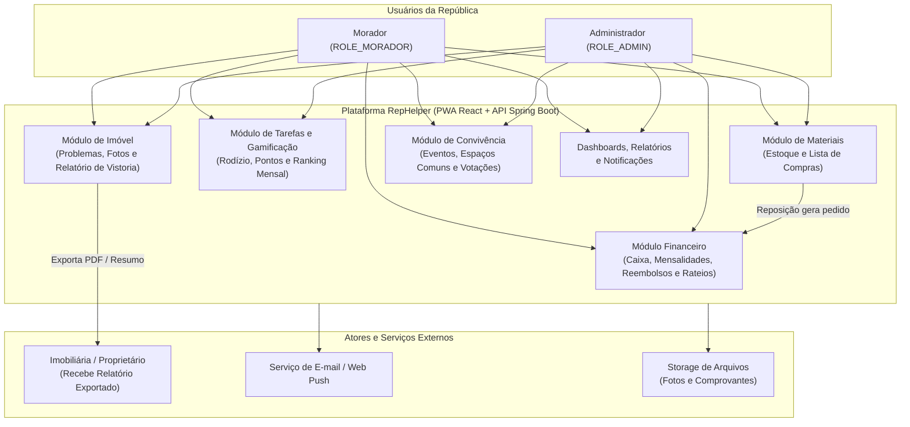

# Visão Geral do Produto

O **RepHelper** é uma aplicação web progressiva (**PWA — Progressive Web App**) construída em **React** no front-end e **Java (Spring Boot)** com **PostgreSQL** no back-end. Projetada sob o paradigma *Mobile-First*, oferece experiência nativa tanto em smartphones (Android e iOS, podendo ser instalada na tela inicial) quanto em computadores desktop.

## Diagrama de Contexto do Produto

## Principais Pilares de Valor

1. **Transparência Financeira Realista**: Substitui planilhas confusas pelo modelo real de **Caixa Comunitário + Mensalidades + Reembolsos aprovados pelo Admin**.
2. **Engajamento sem Atrito**: Transforma obrigações domésticas em uma dinâmica justa e mensurável por meio de rodízios automáticos e **Gamificação mensal**.
3. **Rastreabilidade e Segurança Jurídica**: Preserva o histórico de problemas estruturais do imóvel com fotos datadas para proteger os estudantes perante imobiliárias.
4. **Democracia Interna**: Centraliza enquetes, reservas de espaços e eventos da casa em um único ambiente.
