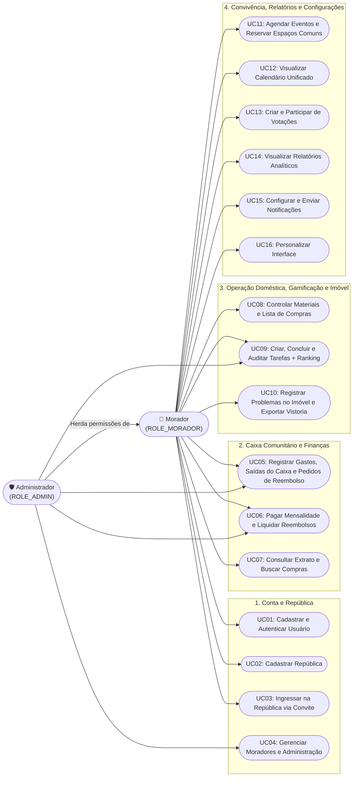

# Introdução — Especificação de Casos de Uso

Esta seção documenta detalhadamente os **Casos de Uso (`UC`)** do sistema **RepHelper**, descrevendo a interação passo a passo entre os atores (**Morador `ROLE_MORADOR`** e **Administrador `ROLE_ADMIN`**) e a plataforma, incluindo pré-condições, pós-condições, fluxos principais, fluxos alternativos/exceções e regras de negócio aplicáveis.

## Diagrama Geral de Casos de Uso

## Catálogo de Casos de Uso

1. **[UC01 — Cadastrar e Autenticar Usuário](cadastrar-usuario.md)** (`RF001`, `RF002`, `RF003`)
2. **[UC02 — Cadastrar República](cadastrar-republica.md)** (`RF004`)
3. **[UC03 — Ingressar na República via Código de Convite](cadastrar-usuario-na-republica.md)** (`RF005`)
4. **[UC04 — Gerenciar Moradores e Administração da República](gerenciar-usuarios.md)** (`RF006`)
5. **[UC05 — Registrar Gastos, Saídas do Caixa, Solicitar Reembolso e Rateios](registrar-gasto.md)** (`RF008`, `RF009`, `RF011`)
6. **[UC06 — Pagar Mensalidade Fixa e Aprovar/Liquidar Reembolsos](realizar-pagamento.md)** (`RF007`, `RF010`)
7. **[UC07 — Consultar Extrato do Caixa e Buscar Compras Realizadas](buscar-compras.md)** (`RF012`)
8. **[UC08 — Controlar Materiais e Lista de Compras Integrada](controlar-materiais.md)** (`RF013`, `RF014`)
9. **[UC09 — Criar, Concluir e Auditar Tarefas Domésticas (Gamificação e Ranking)](criar-tarefa.md)** (`RF015`, `RF016`, `RF017`, `RF018`)
10. **[UC10 — Registrar Problema no Imóvel e Exportar Relatório de Vistoria](registrar-problema.md)** (`RF019`, `RF020`)
11. **[UC11 — Agendar Evento e Reservar Espaço Comum](agendar-evento.md)** (`RF021`)
12. **[UC12 — Visualizar Calendário Unificado da República](visualizar-calendario.md)** (`RF022`)
13. **[UC13 — Criar e Participar de Votações (Enquetes)](participar-de-votacoes.md)** (`RF023`)
14. **[UC14 — Visualizar Relatórios e Gráficos Analíticos](visualizar-relatorios.md)** (`RF024`)
15. **[UC15 — Configurar e Enviar Notificações](configurar-notificacoes.md)** (`RF025`)
16. **[UC16 — Personalizar Interface do Aplicativo](personalizar-interface.md)** (`RF026`)

