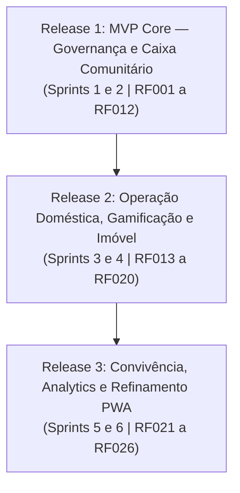

# Cronograma e Roadmap de Entregas

O desenvolvimento do **RepHelper** é estruturado em **3 Releases Incrementais**, compostas por **6 Sprints** de 2 semanas cada. Essa organização garante que as fundações arquiteturais e o núcleo financeiro sejam entregues primeiro, seguidos pelos módulos operacionais e de convivência.

## 1. Visão Geral das Releases

---

## 2. Detalhamento por Sprint e Entregáveis

| Release | Sprint | Foco da Sprint | Requisitos Funcionais Entregues | Principais Entregáveis Técnicos |
| :--- | :---: | :--- | :--- | :--- |
| **Release 1 (MVP Core)** | **Sprint 1** | Fundação, Autenticação, República e Membros | `RF001`, `RF002`, `RF003`, `RF004`, `RF005`, `RF006` | Setup do monorepo/repositórios (React + Spring Boot + PostgreSQL + Flyway), Autenticação JWT, Criação de República, Código de Convite e Gestão de Moradores (`RN001`–`RN003`). |
| **Release 1 (MVP Core)** | **Sprint 2** | Caixa Comunitário, Mensalidades, Reembolsos e Rateios | `RF007`, `RF008`, `RF009`, `RF010`, `RF011`, `RF012` | Motor do Caixa Comunitário (`RN004`), cobrança e confirmação de Mensalidades Fixas, Saídas Diretas do Caixa, Solicitação e Aprovação de Reembolsos (Pix ou Abatimento na Mensalidade — `RN005`, `RN006`), Rateios Extras e Extrato/Busca. |
| **Release 2 (Operação e Imóvel)** | **Sprint 3** | Controle de Materiais Integrado + Tarefas e Gamificação | `RF013`, `RF014`, `RF015`, `RF016`, `RF017`, `RF018` | Estoque e Lista de Compras integrada ao pedido de reembolso (`RN007`), Tarefas únicas e recorrentes com rodízio automático (`RN008`), Pontuação por dificuldade (`RN009`), Auditoria/Estorno pelo Admin (`RN010`) e Ranking Mensal / "Morador do Mês" (`RN011`). |
| **Release 2 (Operação e Imóvel)** | **Sprint 4** | Problemas no Imóvel e Exportação de Vistoria | `RF019`, `RF020` | Registro de problemas estruturais com upload de fotos, controle de status (`RN012`) e geração/exportação de relatório em PDF/resumo para envio à imobiliária/proprietário. |
| **Release 3 (Convivência e Analytics)** | **Sprint 5** | Eventos, Reserva de Espaços Comuns e Votações | `RF021`, `RF022`, `RF023` | Calendário unificado da república, reserva de espaços comuns com trava anti-conflito (`RN013`) e sistema de Votações/Enquetes com apuração e prazo (`RN014`). |
| **Release 3 (Convivência e Analytics)** | **Sprint 6** | Relatórios Gráficos, Notificações, Temas e PWA | `RF024`, `RF025`, `RF026` | Dashboards e gráficos analíticos, central de notificações (In-App, Web Push e E-mail), personalização de tema Claro/Escuro, configuração final do PWA e testes ponta a ponta. |

---

## 3. Diretrizes de Controle de Entregas

- **Versionamento**: Todo o código-fonte e a documentação técnica são mantidos em repositório Git (GitHub), utilizando *branches* por funcionalidade (`feature/RFxxx-descricao`) e *tags* de versão ao término de cada Release (`v1.0.0`, `v2.0.0`, `v3.0.0`).
- **Independência Incremental**: Caso ocorra variação de esforço em funcionalidades desejáveis, os módulos essenciais de cada Release permanecem isolados e prontos para uso em produção.
