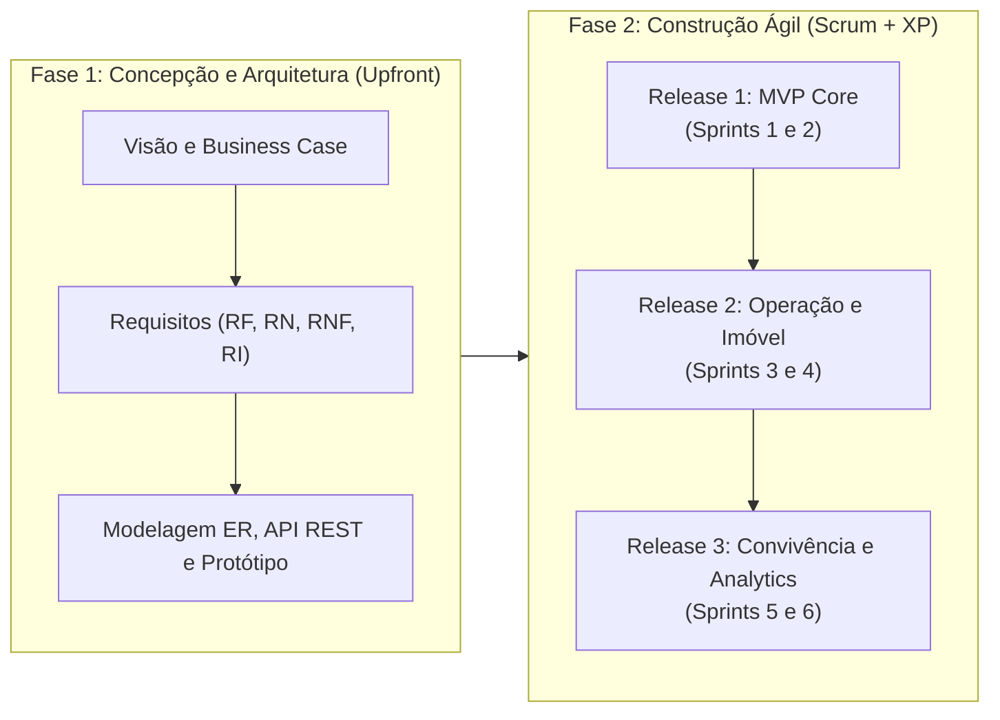

# Metodologia de Desenvolvimento

O desenvolvimento do **RepHelper** adota uma **Metodologia Híbrida**, combinando a previsibilidade da fase de concepção e arquitetura (*Upfront Specification & Architecture*) com a agilidade de execução e entrega contínua do **Scrum** aliado às práticas de engenharia do **Extreme Programming (XP)**.

## 1. Fase de Concepção e Especificação (Base Estruturada)

Antes do início da codificação das Sprints, o projeto consolida:
- **Visão de Produto e Regras de Domínio**: Definição precisa do modelo de Caixa Comunitário, Reembolsos, Estoque Integrado, Gamificação e Gestão do Imóvel.
- **Especificação de Requisitos e Casos de Uso**: Catálogo rastreável de `RF`, `RN`, `RNF` e `RI`.
- **Arquitetura e Contratos de Dados**: Modelo Entidade-Relacionamento no PostgreSQL, contratos de endpoints REST no Spring Boot e wireframes validados no Figma.

## 2. Fase de Desenvolvimento Iterativo (Scrum + XP)

Com a base arquitetural definida, a implementação ocorre em **Sprints de 2 semanas**, agrupadas em **3 Releases funcionais**:

### Práticas do Scrum Adotadas
- **Product Backlog Priorizado**: Todos os 26 Requisitos Funcionais são decompostos em *User Stories* técnicas no repositório (GitHub Projects/Issues).
- **Sprints Time-boxed**: Ciclos curtos com meta clara (*Sprint Goal*) e entrega de incremento funcional testável ao final de cada ciclo.
- **Rituais Regulares**: *Sprint Planning*, *Daily Scrum*, *Sprint Review* e *Sprint Retrospective*.

### Práticas de Engenharia do XP (Extreme Programming)
- **Pair Programming (Programação em Pares)**: Especialmente nas regras críticas de negócio (cálculo do Caixa Comunitário, abatimento de reembolsos em mensalidades e rodízio/auditoria de tarefas).
- **Integração Contínua e Pull Requests (CI / Code Review)**: Nenhuma alteração entra na branch principal (`main`) sem revisão de código e execução automatizada de testes.
- **Testes Automatizados Contínuos**: Testes unitários (JUnit 5 / Mockito no Spring Boot) para todas as Regras de Negócio (`RN001`–`RN017`) e testes de integração das rotas REST.
